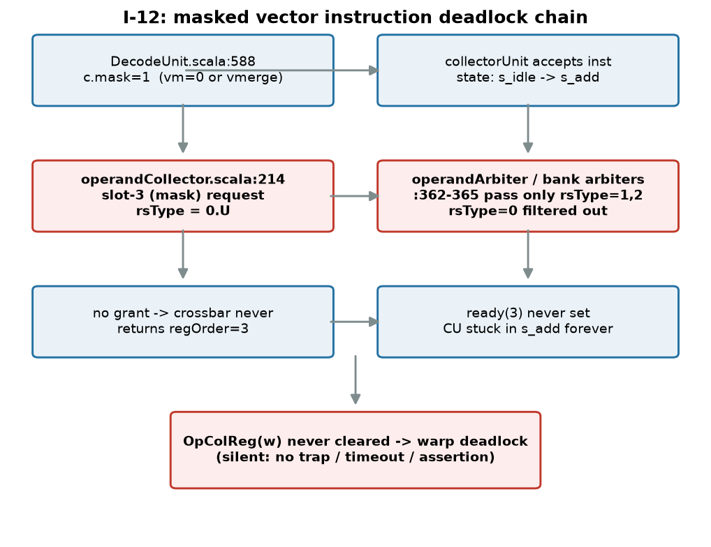

> English translation of the Chinese master `doc/bugs/I-12-掩码向量指令死锁.md`. Translated 2026-09-13.

# I-12 Defect Analysis Report: Masked vector instructions (vm=0 and all vmerge) deadlock in collectorUnit

| Item | Content |
|---|---|
| ID | I-12 |
| Source location | `ventus/src/pipeline/operandCollector.scala:214` (mask read request rsType=0); `:362-365` (two-level arbiters only admit rsType=1/2); linked sites `DecodeUnit.scala:588`, `:367-369`, `regfile.scala:59-61` |
| Type | Functional bug (deadlock) — cross-module maintenance drift |
| Severity | **High** (all masked vector instructions unusable; a single instruction deadlocks, and the deadlock is silent — no trap, no timeout, no assertion) |
| Status | 【Confirmed】, fixed version modeled and verified + patched-tree ChiselSim regression green |
| Key evidence | 【Lean machine-checked proof】CU-level deadlock theorem + system-level closed-loop theorem + whole-machine 40-cycle stall witness; 【simulation】ChiselSim module-level repro + Verilator whole-machine repro (one of the 8/9 reproduced target bugs); 【source reading】four source files line-verified |
| Lean model | `lean/Ventus/Schedule/CollectorUnit.lean` (CU level), `lean/Ventus/Schedule/OperandCollector.lean` (system level), `lean/Ventus/SMMaskedMem.lean` (whole-machine demo, 208 lines); fixed version `lean/VentusF/Schedule.lean` |
| Repro/patch | `repro/OperandCollectorBugRepro.scala` (ChiselSim); `repro/verilator/` kernel `i12_vmerge_deadlock`; patch `i12-operandcollector-mask-rstype.patch` (internal fix manifest; not released) |
| Related entries | I-13 (same module, mixed use of old and new signals), I-50 (vmerge write-mask deviation exposed after the fix, doc/28), B1 remark (vmerge semantics), I-4 (same-module race) |

---

## 0. Abstract

The Ventus operand collector (operandCollector) issues 4 read requests per
vector instruction (regOrder 0–3: rs1, rs2, rs3, mask), and the mask
request's rsType field is hard-coded to `0.U` (operandCollector.scala:214).
Meanwhile, the two arbiters on the bank side (operandArbiter and bankArbiter)
only admit requests with rsType=1 (scalar) or rsType=2 (vector)
(operandCollector.scala:362-365) — **the rsType=0 mask request is filtered
out by both levels of arbitration and is never granted**. Consequently, any
masked vector instruction (vm=0, and all vmerge — decoding forces mask=1)
never receives its regOrder=3 return inside the collectorUnit; the state
machine stays forever in s_add, the CU is permanently occupied, the warp's
scoreboard occupancy bit is never cleared, and the **warp deadlocks**.

This entry is one of the project's most important findings (the "flagship
bug"): it is not an error inside any single module, but **cross-module
maintenance drift** — the regfile side has already half-dismantled the v0
mask read datapath (tied to all-ones, with a self-documenting comment "v0
mask is not used in the current implementation"), while the decode side and
the collect side still work to the original design of "mask read from the v0
register". Each module is locally self-consistent; combined, they deadlock
systematically. This is exactly the class of defect that simulation is least
likely to find and that the cross-module compositional reasoning of formal
methods is best at hitting.

The evidence chain is a complete closed loop: Lean machine-checked proof
(CU-level conditional theorem → arbitration/crossbar facts → system-level
closed loop → whole-machine 40-cycle stall witness) + ChiselSim module-level
reproduction + Verilator whole-machine reproduction + fix patch (i12, two
edit points) verified green in patched-tree regression. After the fix, a
second-layer defect I-50 was exposed (vmerge write mask deviates from RVV),
filed separately.

---

## 1. Module function and design intent

### 1.1 Background concepts

- **SIMT masking**: a GPU executes in lockstep in units of warps (32
  threads). Vector instructions may be masked (when vm=0 the v0 register
  supplies a 32-bit mask); lanes whose mask bit is 0 are not written back.
  RISC-V Vector (RVV) compliance requires supporting vm=0.
- **Operand collector (operandCollector)**: the buffering structure between
  the GPU's issue stage and the register file. The register file is organized
  by banks (4 banks); two addresses of the same bank cannot be read in the
  same cycle, so an instruction's operands cannot all be fetched at once.
  Instead, the collectorUnits (CU, 8 in total) issue read requests to the
  bank arbiters cycle by cycle, and the instruction may only issue once all 4
  operands have been collected.
- **regOrder and rsType**: each instruction produces 4 read-request slots in
  the CU: regOrder=0/1/2 correspond to rs1/rs2/rs3, and regOrder=3
  corresponds to the **mask**. Each request carries an rsType field:
  1=scalar channel, 2=vector channel, 0=(by design intent) "no
  request/placeholder".
- **collectorUnit state machine**: s_idle (accept new instruction) → s_add
  (issue read requests, wait for returns) → s_valid (all collected, ready to
  issue). `ready(k)` marks operand k as ready; when no mask is needed
  (`!mask`), ready(3) is set directly to skip.

### 1.2 Design intent

After an instruction is decoded, DecodeUnit produces the `c.mask` flag
(whether this instruction needs a mask). For an instruction that needs a
mask, the CU issues a regOrder=3 read request to read the v0 register row;
on return it fills `mask(x)` and sets ready(3), and once all four ready bits
are set it enters the issuable state.

---

## 2. Construct-by-construct reading of the original code

**Construct 1: the mask request's rsType is hard-wired to 0** (`operandCollector.scala:214`, ★defect site):

```scala
rsTypeWire(2) := MuxLookup(io.control.bits.alu_fn, 0.U)(Seq(
  A3_SD -> Mux(io.control.bits.isvec, 2.U, 1.U),
  A3_FRS3 -> 1.U
))
rsTypeWire(3) := 0.U(2.W) //mask        // ★ the regOrder=3 (mask) request's type is constantly 0
```

Contrast: the rs1/rs2/rs3 slots all correctly produce 1.U (scalar) or 2.U
(vector) according to the decode result.

**Construct 2: the two-level arbiters only admit rsType=1/2** (`operandCollector.scala:362-365`):

```scala
// Input filtering of operandArbiter / bankArbiterScalar / bankArbiterVector:
//   valid = original valid && (rsType===1.U)   (scalar arbiter)
//   valid = original valid && (rsType===2.U)   (vector arbiter)
```

An rsType=0 request is filtered out at the input of both arbiters — no
channel can deliver the mask request into a bank. The crossbar therefore
never returns regOrder=3 data to that CU.

**Construct 3: the CU side waits for the mask return** (`operandCollector.scala:248`, `:311-315`):

```scala
when(!mask) { ready(3) := 1.U }                    // skip when no mask is needed
...
}.elsewhen(io.bankIn(i).bits.regOrder === 3.U) {   // wait for the regOrder=3 return
  (0 until num_thread).foreach(x => {
    mask(x) := io.bankIn(i).bits.v0(0).apply(x)    // take the mask from the v0 field
  })
  ready(3) := 1.U
}
```

`DecodeUnit.scala:588` decides which instructions need a mask:

```scala
c.mask := ((~inst(25)) | alu_fn===FN_VMERGE) & c.isvec & !c.disable_mask
```

That is: **any vm=0 vector instruction** (inst(25)=0) and **all vmerge** (the
three VMERGE_VVM/VXM/VIM; disable_mask=N at DecodeUnit.scala:367-369 forces
mask=1).

**Construct 4 (the other half of the maintenance drift): the v0 datapath is already half-dismantled** (`regfile.scala:59-61`):

```scala
// v0 mask is not used in the current implementation, remove it to reduce a read port
// (the vector banks' v0 read port is tied to all-ones)
```

The register-file side's comment self-documents that the v0 mask path is
deprecated; yet the decode side (upstream of construct 3) and the collect
side (constructs 1/3) are still designed around "mask read from v0". The two
layers of drift stack: even if construct 1's rsType were fixed to 2.U so the
request goes through, what construct 3 reads from the `v0` field would be
all-ones — vmerge would degenerate to always selecting vs1. This dictates
that the fix must have two edit points (see §7).

---

## 3. Defect analysis



### 3.1 Precise description of the defect

The deadlock chain (7 links, each with machine-checked proof or source
reading evidence):

1. Decode: a vm=0 vector instruction or a vmerge ⇒ `c.mask=1`
   (DecodeUnit.scala:588);
2. The CU accepts the instruction (s_idle → s_add); mask=1 means the `!mask`
   branch does not fire, so ready(3)=0;
3. The CU issues a regOrder=3 read request with rsType≡0
   (operandCollector.scala:214);
4. rsType=0 is filtered out by both the operandArbiter and the bank arbiters
   (:362-365), never granted;
5. The crossbar never returns regOrder=3 data ⇒ ready(3) never arrives;
6. The CU stays forever in s_add: `control.ready=false`, the CU permanently
   occupied;
7. The warp's OpColReg occupancy bit (scoreboard) is never cleared ⇒ **warp
   deadlock**, with no trap, no timeout, no assertion — silent hang.

Trigger surface: all vm=0 vector instructions + all vmerge
(vmerge.vvm/vxm/vim). A single instruction triggers it; no special timing, no
multi-warp contention needed — this is a "easiest to trigger" class of
high-severity defect.

### 3.2 Root cause

**Cross-module maintenance drift**, not any single-point coding error:

- The regfile side deprecated the v0 mask read path (saving a read port) and
  left a comment;
- The decode side and collect side were not updated in sync: the mask request
  is still issued, and its rsType field still uses an encoding 0 that no
  arbitration channel accepts (presumably rsType=0 originally meant "no
  request on this slot"; after being repurposed for the mask slot, the
  filtering logic filters it out along with the rest);
- Every module is "locally self-consistent" on its own: the regfile is not
  wrong (it indeed does not provide v0), the arbiters are not wrong (rsType=0
  was never a legal request type), the CU is not wrong (it faithfully waits
  for the return). The error exists only in the **semantic misalignment at
  the inter-module interfaces**.

This explains why upstream testing never exposed it: the current repo's test
kernels all use unmasked instructions or branch-based predication (verified
during reproduction: the vmerge in the official vecadd is never on the
execution path) — a vm=0 instruction has never been issued.

### 3.3 Impact and tolerability

- **Impact**: RVV compliance fails outright (vm=0 is mandatory in RVV); any
  kernel that uses masking (vmerge is a common product of compiler predicate
  generation) silently deadlocks on hardware. The deadlock is a
  machine-level liveness failure: the warp never halts, there is no finished
  signal, and the host observes a kernel that never returns.
- **Tolerability**: unobservable under the current official software stack
  (no masked kernels) — a case of "landmine not stepped on", not "no
  landmine". It is fatal as soon as the software stack enables masking (the
  RVV-compliance direction). Rating: **High**.

### 3.4 Relationship to related entries

- **I-50** (vmerge write mask deviates from RVV): only after I-12 is fixed
  and the mask path works does the unconditional overwrite of `wvd_mask` at
  execution.scala:559 become an observable problem — I-50 is I-12's
  "exposed by the fix" follow-up (dedicated adjudication in doc/28).
- **I-13** (regOrder=2 branch mixes old and new control signals): same
  module, same class of "old and new designs coexisting" drift, but currently
  masked by timing.
- **`wvd_mask(x):=true.B` at execution.scala:541** (vmerge all-lane write
  intent) is unconditionally overwritten into dead code by :559 — upstream it
  is intercepted by the I-12 deadlock, making it a latent downstream item of
  I-12.

---

## 4. Lean formal evidence

Two-level chaining plus a whole-machine demonstration, all machine-checked
(zero sorry, full build passes):

**CU level** (`lean/Ventus/Schedule/CollectorUnit.lean`):

- `cuWmask_deadlock` (:1136): a masked instruction + an input sequence that
  never carries a regOrder=3 return ⇒ stays forever in s_add with
  `control.ready=false` (conditional theorem; premise h3 carried explicitly);
- Numerical witnesses `cuT_deadlock_*`: concrete traces pin down the stall
  shape cycle by cycle.

**System level** (`lean/Ventus/Schedule/OperandCollector.lean`) — discharging
every premise of the CU-level theorem into system facts:

- `ocA_filter_rt0`: an rsType=0 request has valid=false after the two-level
  arbiter filtering;
- `ocA_no_grant3`: neither arbiter of any bank grants a slot-3 request;
- `ocXbar_port3_never_valid`: with no bank granting, the crossbar's
  regOrder=3 return port is never valid;
- `ocI12_cu_rsType3_run`: reachable-state invariant — a CU's slot-3 request
  has rsType≡0;
- The closed-loop theorem **`ocI12_deadlock_system`**: the instantiation of
  `cuWmask_deadlock` under the real crossbar driver, with all premises
  discharged into system facts.

**Whole-machine demonstration** (`lean/Ventus/SMMaskedMem.lean`, 208 lines):
a 40-cycle stall witness of a vm=0 partially-masked memory-access program
(SMMaskedMem.lean:198-200) — fetch normal, decode normal, nothing issues
after the CU accepts; nMskRsp=0 (the whole-machine projection of the I-12
filtering), zero LSU/ShareMem requests, zero endprg issues.

**Fixed-version verification** (`lean/VentusF/Schedule.lean`):
`fschCu_mask_req_admissible` (after the fix, mask requests can be accepted by
arbitration), `fschCuT_masked_issues` (a masked instruction collects and
issues normally, contrasting the original deadlock), `fschCuRun_mod3`, etc.;
in the fixed-version whole-machine composition (`VentusF/SM.lean §6`) the
original witnesses turn green
(`fsmT_i12_mask_returns`/`fsmT_i12_orig_never`/`fsmT_i12_cu_collected`).

---

## 5. Simulation verification (dual-channel execution + patched-tree regression)

**ChiselSim module level** (`repro/OperandCollectorBugRepro.scala`, executed
2026-09-06/07, doc/22): a vmerge-shaped instruction with mask=1 **did not
issue within 30 cycles (deadlock)**; the control group, a same-shaped mask=0
vadd, issued normally. Verdict: **reproduction succeeded**.

**Verilator whole-machine level** (`repro/verilator/` kernel
`i12_vmerge_deadlock`, executed 2026-09-07, doc/22): canary word
`mem[0x90000000]=0xDEAD0001` was written (proving the kernel started and
executed up to just before the deadlock point), the PASS word remained at the
sentinel `0xEEEEEEEE`, no finished log, and the simulation ran to the
`--sim-time-max 20000` limit — the vmerge deadlock holds in the real-RTL
whole-machine environment. Verdict: **reproduction succeeded** (one of the 8
reproduced among 9 target bugs).

**Patched-tree regression** (38-patch merged tree, executed 2026-09-10,
doc/22): OperandCollectorBugRepro **3/3 green** — I-12 masked instructions
issue normally, and the I-11 aliasing is gone; vmerge write-mask semantics
are not covered by this suite (that is I-50, filed separately).

---

## 6. Upstream impact analysis

- **Trigger surface**: all vm=0 vector instructions and all vmerge. Decode
  path: DecodeUnit.scala:588 (mask condition) → issue → collectorUnit, with
  no downstream compensation point.
- **Why upstream never found it**: the current repo's test kernels are all
  unmasked or branch-predication based (including the official vecadd, whose
  vmerge is not on the execution path); FPGA deployments likewise never hit
  it. A "test coverage blind spot", not a "design exemption".
- **Upstream corroboration**: the comment at regfile.scala:59-61 proves the
  maintainers knew the v0 path was deprecated, but the collect side was not
  updated in sync — the drift spans at least one refactoring.
- **The second layer after the fix**: with the v0 path tied to all-ones ⇒ if
  the fix only changed rsType without changing the data source, vmerge would
  degenerate to always selecting vs1 (a second-layer functional error); I-50
  further adjudicates that the fixed version's vmerge write mask still
  deviates from RVV (lanes with tmask=1∧v0[t]=0 are not written).

---

## 7. Fix and fix verification

**Decision D1 (user-approved 2026-08-31)**: repair the mask path (an
ISA-visible change); the data source is switched to `data(0)` (the lane0 word
of the v0 row) instead of the dead v0 field.

**Patch** (`i12-operandcollector-mask-rstype.patch` (internal fix manifest; not released),
two edit points):

1. `operandCollector.scala:214`: `rsTypeWire(3) := 0.U` → `2.U` — connects
   the mask request to the vector channel;
2. `operandCollector.scala:313`: `mask(x) := io.bankIn(i).bits.v0(0).apply(x)`
   → `io.bankIn(i).bits.data(0)(x)` — the mask bits are taken from the lane0
   word of the data returned on the vector read port (the v0 field has been
   tied to all-ones by the regfile, so the original data path is unusable).

**Three-part fix verification**:

- Effectiveness: Lean fixed-version theorems (§4 `fschCu*`/`fsmT_i12_*`) +
  ChiselSim patched-tree regression 3/3 green (masked instructions issue
  normally);
- Regression safety: the fixed-version CU is step-by-step equivalent to the
  original on the non-triggering domain (unmasked instructions) (regression
  equivalence theorem family in VentusF/Schedule.lean); 38-patch merged-tree
  regression shows no collateral damage;
- Follow-up: I-50 (vmerge write-mask deviation) has been adjudicated; the fix
  recommended in doc/28 is option A (add a tmask field to vExeData +
  conditionalize execution.scala:559); one **must not** simply activate the
  all-true dead code at :541 (it would corrupt the inactive lanes with
  tmask=0 — worse than the status quo).

---

## 8. Conclusion

| Evidence layer | Content | Strength |
|---|---|---|
| Source reading | Line-by-line verification of operandCollector.scala:214 / :362-365 / :248 / :311-315, DecodeUnit.scala:588, regfile.scala:59-61 | Four source files consistent |
| Lean machine-checked proof | `cuWmask_deadlock` → `ocA_filter_rt0`/`ocA_no_grant3`/`ocXbar_port3_never_valid` → `ocI12_deadlock_system` closed loop; whole-machine 40-cycle witness (SMMaskedMem) | Universal/reachable-state level |
| ChiselSim repro | mask=1 instruction did not issue within 30 cycles; control group normal | Executed |
| Verilator whole-machine repro | canary written, PASS sentinel untouched, no finished, ran to the 20000-cycle limit | Executed |
| Fix verification | i12 patch (2 edit points); Lean fixed-version theorems + patched-tree regression 3/3 green; regression equivalence | Executed + machine-checked |

I-12 is a model instance of the "cross-module maintenance drift" defect type:
three modules each locally self-consistent, yet combined they silently
deadlock the entire family of masked vector instructions. Its evidence chain
(machine-checked closed loop + dual-channel RTL reproduction + fix
regression) is the most complete among this project's 50+ findings, and the
primary empirical exhibit for the claim that "formal methods can find exactly
the class of bugs that simulation finds hardest".
