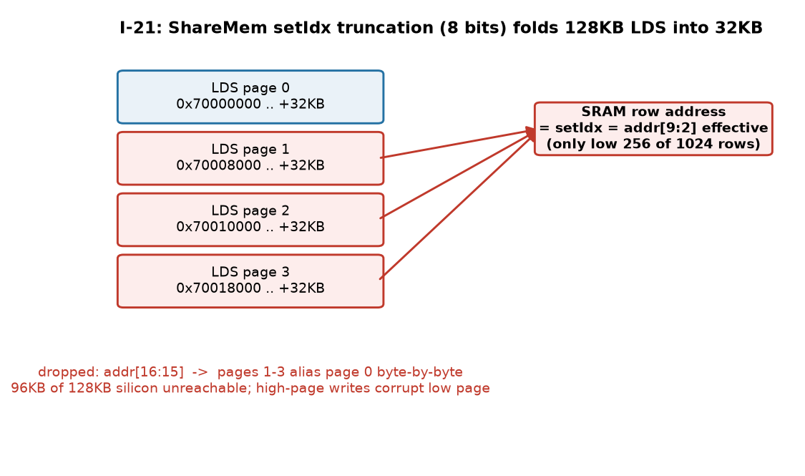

> English translation of the Chinese master `doc/bugs/I-21-ShareMem地址别名.md`. Translated 2026-09-13.

# I-21 Detailed Defect Analysis Report: ShareMem request setIdx is only 8 bits — the upper 96KB of LDS aliases the lower 32KB byte-for-byte

| Item | Content |
|---|---|
| ID | I-21 |
| Source location | `ventus/src/pipeline/LSU.scala:71` (`ShareMemCoreReq_np.setIdx` uses `dcache_SetIdxBits`=8 bits), `:171` (`setIdx` takes addr(14,7)), `:216` (`to_shared.bits.setIdx := setIdx`); compare `L1Cache/ShareMem/ShareMemParameters.scala:22` (NSets=sharedmem_depth=1024, needs 10-bit row address, `top/parameters.scala:93`); connection point `top/GPGPU_top.scala:488` (8→10 bit zero-extension) |
| Type | Functional bug (silent data corruption) — bit-width mismatch / address truncation |
| Severity | **High** (when LDS usage on an SM exceeds 32KB, upper-region writes silently overwrite the lower region, and shared memory of different CTAs stomps on each other; moreover 96KB of the 128KB physical capacity is a hardware dead zone) |
| Confirmation status | 【Confirmed】 — reproduced through both the ChiselSim module-level and Verilator whole-machine channels; the fix patch turns the patch-tree regression green |
| Main evidence | 【Lean machine-checked proof】 aliasing/dead-zone symbolic theorems + an 8-cycle end-to-end witness; 【simulation runs】 ChiselSim (setIdx measured 0, expected 256) + Verilator (upper-region write, lower-region read returns 0x22222222); 【direct source reading】 four source files checked line by line at the cited line numbers |
| Lean model | `lean/Ventus/Mem/ShareMem.lean` (the I-21 write-off site); fixed version `lean/VentusF/Mem.lean`, `lean/VentusF/SMMem.lean` |
| Reproduction/patch | `repro/ShareMemAddrAliasRepro.scala` (ChiselSim, module-level AddrCalculate); `repro/verilator/kernels/i21_lds_alias.*` (whole-machine kernel); patch `i21-sharedmem-setidx.patch` (internal fix manifest; not released) |
| Related entries | I-11 (the same kind of defect: register-file address width insufficiency); SRAMTemplate Q1 (the bypassWrite=true path of ShareMem banks, unrelated to this entry) |

---

## 0. Summary

Each Ventus SM is equipped with 128KB of shared memory (ShareMem, LDS): 32 banks × 1024 rows × 4 bytes — a **tagless**, direct-mapped scratchpad whose only addressing basis is setIdx (a 10-bit row address).
But in the shared-memory requests issued by the LSU, the setIdx field reuses the DCache's bit width
(`dcache_SetIdxBits`=8), and the slice takes addr(14,7); at the connection point into ShareMem
(GPGPU_top.scala:488) these 8 bits are simply zero-extended to 10 bits. **Address bits addr(16,15)
are unconditionally discarded on this path.**

Consequence: within the LDS address space, every 32KB page aliases every other byte-for-byte — the upper 96KB (3 pages in total) and the lower
32KB (page 0) access exactly the same physical SRAM rows. The `is_shared` bounds check (LSU.scala:162)
admits the entire 128KB window, and there is no further interception point along the aliasing path (ShareMem has no tags, and the LSU's
same_tag grouping only splits requests — it does not block aliasing). Therefore **upper-region writes silently overwrite lower-region data** — the Lean end-to-end
witness (write 0x70008040, then read 0x70000040 returns the upper-region value 0x22222222) agrees exactly with the
whole-machine Verilator measurement. Collateral damage: of the 1024 SRAM rows per bank, only the lower 256 rows are addressable —
**only 32KB of the 128KB silicon is usable; 96KB is a hardware dead zone**.

Trigger surface = "LDS usage on a single SM > 32KB". The CTA scheduling side allows up to 128KB (NUM_LDS_MAX =
sharemem_size), so a legal configuration is sufficient to trigger it.

---

## 1. Module Function and Design Intent

### 1.1 Background Concepts

- **LDS / shared memory (ShareMem)**: a piece of on-chip, software-managed storage (scratchpad) on each SM (Streaming Multiprocessor) of the GPU.
  Warps within the same CTA (thread block) use it to exchange data; it corresponds to OpenCL's local memory and CUDA's shared memory.
  Ventus's LDS addresses start at `LDS_BASE = 0x70000000` (parameters.scala:136),
  with capacity 128KB = 1024 sets × 32 words × 4 bytes (parameters.scala:93/95/97).
- **LSU and AddrCalculate**: the load/store unit groups the 32 lane addresses of a memory instruction
  by "same tag+setIdx" (same_tag), splits them into one or more requests, and sends them to the DCache
  (global memory) or to ShareMem respectively (addresses falling in the LDS window take the shared path;
  bounds checked at LSU.scala:162, instantiated at :554, window parameter = sharemem_size = 128KB).
- **setIdx / tag**: in a cache, the address is split into tag + setIdx + block offset, and the tag is used
  for hit comparison. ShareMem is a scratchpad, not a cache — **no tags, no hit logic**;
  software guarantees addresses stay in bounds, and the hardware indexes SRAM rows directly by setIdx. Therefore the setIdx width
  must cover all 1024 rows (10 bits); every missing bit means two addresses share one physical row.

### 1.2 Design Intent

The LSU issues `ShareMemCoreReq_np` requests (setIdx + per-lane blockOffset/
wordOffset1H/activeMask + data + isWrite), which are connected at the top level into ShareMem;
inside ShareMem, the BankConflictArbiter arbitrates bank conflicts, and the 32 banks
(each 1024 rows × 4 bytes, SRAMTemplate configured with bypassWrite=true) serve requests in parallel;
responses return through a 32-deep pipe queue to the pipeline writeback stage.

---

## 2. Construct-by-Construct Reading of the Original Code

**Construct 1: the request bundle's setIdx field reuses the DCache width (8 bits)** (`LSU.scala:71`, ★ fault point):

```scala
// LSU.scala:66-77, class ShareMemCoreReq_np
  val instrId = UInt(log2Up(lsu_nMshrEntry).W)
  val isWrite = Bool()
  //val tag = UInt(dcache_TagBits.W)              // :70 — tag field commented out
  val setIdx = UInt(dcache_SetIdxBits.W)           // :71 ★ 8 bits (ShareMem needs 10 bits)
  val perLaneAddr = Vec(num_thread, new ShareMemPerLaneAddr_np)
```

**Construct 2: the setIdx slice takes addr(14,7), discarding addr(16,15)** (`LSU.scala:171`, ★ fault point):

```scala
// LSU.scala:170-171 (inside AddrCalculate)
val tag    = Mux(reg_save.mask.asUInt=/=0.U, addr_wire(xLen-1, xLen-1-dcache_TagBits+1), 0.U(dcache_TagBits.W))
val setIdx = Mux(reg_save.mask.asUInt=/=0.U, addr_wire(xLen-1-dcache_TagBits, xLen-1-dcache_TagBits-dcache_SetIdxBits+1), 0.U(dcache_SetIdxBits.W))
```

Substituting the parameters (dcache_TagBits=17, dcache_SetIdxBits=8): tag = addr(31,17),
setIdx = addr(14,7). The correct row address for ShareMem's 1024 rows should be addr(16,7) (10 bits) —
**the two bits addr(16,15) are never sliced out at the source**.

**Construct 3: sent to ShareMem** (`LSU.scala:216`):

```scala
io.to_shared.bits.setIdx := setIdx    // :216 — the 8-bit truncated value sent out as-is
```

Note that the tag field at `:70` has been commented out — even if one wanted tag comparison to catch the aliasing, there is no tag to send.

**Construct 4: top-level connection zero-extends 8→10** (`GPGPU_top.scala:488`, ★ fault point):

```scala
sharedmem.io.coreReq.bits.setIdx:=pipe.io.shared_req.bits.setIdx   // :488
```

Chisel treats connections of unequal width by zero-extension: the 8-bit setIdx is padded with zeros into the 10-bit port.
**The two discarded address bits are permanently lost here** — the upper 2 bits of the row address seen by ShareMem are always 0.

**Construct 5 (the structural reason there is no interception point): ShareMem has no tags** (`ShareMem.scala:42,63`):

```scala
//val tag = UInt(TagBits.W)                                  // :42 — commented out
...
//val TagAccess = Module(new L1TagAccess(set=NSets, way=NWays, tagBits=TagBits))  // :63 — commented out
```

The sole use of setIdx inside ShareMem is as the SRAM row address (`ShareMem.scala:159-171`;
the DataAccess read/write ports `setIdx := coreReq_st1.setIdx` / `Cat(coreReq_st1.setIdx, …)`).
Nothing else in the whole module uses the high address bits — there is no interception point for the aliasing.

**Construct 6: the bounds check does not block the upper region** (`LSU.scala:162`):

```scala
is_shared(x) := !reg_save.mask(x) || ( addr(x) >= LDS_BASE.U(32.W) && addr(x) < (LDS_BASE.U(32.W) + sharedmemory_maxsize) )
```

The instantiation parameter is `sharedmemory_addr_max = sharemem_size = 128KB` (LSU.scala:548,554),
i.e., all of [LDS_BASE, LDS_BASE+128KB) takes the shared path — upper-96KB addresses legally enter
the aliasing path. The LSU's same_tag grouping (:174-176) splits lanes spanning 32KB pages into separate requests,
but each request still carries the same 8-bit truncated setIdx — **the grouping only splits requests; it does not block aliasing**.

---

## 3. Defect Analysis



### 3.1 Precise Description of the Defect

Aliasing rule: if two LDS addresses agree in their low 15 bits (only addr(16,15) and the tag bits may differ),
then after the LSU slice + top-level zero-extension, all addressing fields visible to ShareMem (setIdx /
blockOffset / byte enables) are identical. The address space folds with a period of 32KB:

| LDS page | Address range (relative to LDS_BASE) | Physical landing |
|---|---|---|
| Page 0 | [0, 32KB) | bank row addr(14,7), normal |
| Page 1 | [32KB, 64KB) | byte-for-byte alias of page 0 (bit15 dropped) |
| Page 2 | [64KB, 96KB) | byte-for-byte alias of page 0 (bit16 dropped) |
| Page 3 | [96KB, 128KB) | byte-for-byte alias of page 0 (both bit15 and bit16 dropped) |

Moreover, of the 1024 SRAM rows per bank, only rows whose row-address low 8 bits participate in addressing (256 rows) are reachable:
after zero-extension the upper 2 bits of setIdx are always 0, so rows 256–1023 physically exist but can never be addressed.

Witness scenario (same shape in the Lean machine proof and the Verilator measurement):

1. t0: write lower region 0x70000040 ← 0x11111111 (lands normally in bank16 row 0);
2. t3: write upper region 0x70008040 (LDS_BASE+32KB+0x40) ← 0x22222222 — addr(15)=1
   is dropped, landing in the same bank16 row 0, **overwriting the lower-region data**;
3. t6: read lower region 0x70000040 → returns 0x22222222 ≠ 0x11111111.

### 3.2 Root Cause

**Cross-module bit-width mismatch**: the LSU-side request bundle (ShareMemCoreReq_np) reuses the DCache
parameter `dcache_SetIdxBits` (8, corresponding to the DCache's 256 sets), while ShareMem has 1024 sets.
Each module is "locally self-consistent" — the LSU faithfully slices the 8 bits it believes are sufficient, and ShareMem faithfully
addresses by the 10-bit row address it receives — the error exists only in the semantic mismatch of the interface width. The two
commented-out sites :70/:63 indicate that ShareMem once had tags (a more cache-like structure); when it was simplified into a pure scratchpad
the tags were removed, but setIdx was not widened in step — this belongs to the same "maintenance drift" pattern as I-12.
Corroborating evidence: the CTA resource-allocation side (NUM_LDS_MAX = sharemem_size = 128KB,
parameters.scala:180) lets a WG request the entire 128KB, and no allocation layer imposes any "<32KB"
restriction — upper-region addresses are normal traffic under a legal configuration.

### 3.3 Harm and Tolerability

- **Harm**: silent data corruption. Upper-region writes overwrite the lower region (lower-region readers get upper-region data), and upper-region reads
  read lower-region data; LDS regions of different CTAs stomp on each other as soon as one is low and the adjacent one is high. 128KB of
  OpenCL local memory is a routine usage level (e.g., 64KB+ matrix tiling); no
  anomalous configuration is needed to trigger it.
- **Dead zone**: only 32KB of the 128KB silicon is addressable (3/4 of the capacity wasted) — an area loss.
- **Tolerability**: programs with LDS usage ≤32KB are unaffected — this is "having not stepped on the mine", not "there is no mine".
  If the existing software stack never used more than 32KB, the bug was never exposed (consistent with the fact that the ChiselSim/Verilator reproductions needed
  deliberately constructed upper-region accesses). Rating: **High** (correctness-level, silent, triggerable under legal configurations).

---

## 4. Lean Formal Evidence

All located in `lean/Ventus/Mem/ShareMem.lean` (closed out 2026-08-27, zero sorries,
`#print axioms` audit archived: native_decide theorems carry `Lean.ofReduceBool`,
bv_decide theorems carry LRAT trust axioms — both expected under v4.31). The LSU-side address functions reuse
`lsuSetOf/lsuBlkOf/lsuWordOff1H` from `Mem/LSU.lean` (D8), keeping the aliasing path
co-sourced with the LSU model; the top-level connection is pinned as the same function `smSetIdxOfAddr` (the 8→10 zero-extension of GPGPU_top.scala:488;
see also `top_shared_setIdx_conn` in `Ventus/Top.lean`).

**Symbolic theorems (bv_decide, arbitrary 32-bit addresses)**:

- `smI21_alias` (ShareMem.lean:424): two addresses with equal low 15 bits ⇒ after the LSU slice +
  zero-extension, setIdx / blockOffset / byte enables are **completely identical** — the aliasing originates at the LSU
  slice, independent of the data;
- `smI21_dead_rows` (:435): the upper 2 bits of the zero-extended setIdx are always 0
  (`smSetIdxOfAddr a &&& 0x300#10 = 0`) — only the lower 256 of the 1024 rows per bank are reachable,
  a 96KB dead zone;
- `smI21_window` (:448, native_decide): all four witness addresses
  (LDS_BASE+0x0040/0x8040/0x10040/0x18040) pass the is_shared bounds check
  (smax=128KB) — upper-region accesses are not routed to the DCache; the aliasing is unobstructed;
- `smI21_req_alias` (:507): the ShareMem addressing fields of two write requests are bit-for-bit identical
  (request-level aliasing).

**End-to-end witness (native_decide, an 8-cycle trace smW2s1..s8 through the full ShareMem pipeline
model)**:

- **`smI21_witness`** (:498): t0 writes 0x70000040←0x11111111, t3 writes
  0x70008040←0x22222222, t6 reads 0x70000040 → the t8-cycle response has valid=1,
  isWrite=0, instrId=7, data=0x22222222 ≠ 0x11111111. Physical location:
  bank16, SRAM row 0, all 4 byte enables — the two requests are indistinguishable inside ShareMem.
  **The upper-region write silently overwriting the lower region is nailed down.**
- Auxiliary: `smI21_witness_fields` (:462, request fields pinned).

**Fixed version (`lean/VentusF/Mem.lean`)**: `fmem_i21_no_dead_rows` (after the fix, the 10-bit
setIdx has no dead zone), `fmem_i21_witness_green` (the original witness trace reads back
the correct value 0x11111111 on the fixed version — turns green), `fmem_i21_regress_low32K` (the lower-32KB behavior is
step-by-step equivalent to the original — regression-safe); the SMMem integration layer `fsmm_shSetIdx_regr`/
`fsmm_shSetIdx_hi_witness` (`lean/VentusF/SMMem.lean:894,913`).

---

## 5. Simulation Verification (Two-Channel Measurement + Patch-Tree Regression)

**ChiselSim module-level** (`repro/ShareMemAddrAliasRepro.scala`, actually run 2026-09-06/07,
ChiselSim channel of doc/22): the reproduction layer is placed at AddrCalculate (LSU.scala:113,
the observation point closest to the lesion — ShareMem itself is not wrong; what is wrong is that the setIdx sent by the LSU is truncated).
Issue a single-lane scalar store to address 0x70008040 (LDS_BASE+32KB+0x40), stop at
s_shared and observe bits: measured `to_shared.setIdx = 0`, **while the correct 10-bit value should be
addr(16,7) = 0x100 = 256** — the discarding of addr(16,15) is established (identical addressing fields to those of 0x70000040).
Verdict: **reproduction successful**, numerically in exact agreement with the Lean-side `smI21_witness`
(the doc/22 node "comparison against Lean-model conclusions").

**Verilator whole-machine** (`repro/verilator/kernels/i21_lds_alias`, actually run 2026-09-07,
Verilator channel of doc/22): on the real-RTL whole machine, write the LDS upper region
0x70008040 = 0x22222222, then read the lower region 0x70000040, **obtaining 0x22222222 (should be
0x11111111)** — the upper/lower-region aliasing holds in the whole-machine environment. Verdict: **reproduction successful**
(one of the 8 reproduced among the 9 target bugs).

**Patch-tree regression** (doc/22, two rounds):

- 35-patch tree (2026-09-07): ShareMemAddrAliasRepro **1/1 green** — the fix turns it green;
- 38-patch merged tree (2026-09-10): same suite EXIT=0, consistent with the 35-tree verdict.

---

## 6. Upstream Impact Analysis

- **Trigger surface**: triggered as soon as LDS usage on an SM exceeds 32KB. The entire allocation chain has no <32KB restriction
  (NUM_LDS_MAX = 128KB); on the software side, requesting more than 32KB of OpenCL local memory is
  routine. No special timing, no multi-warp contention needed — a single warp with two memory instructions suffices to reproduce it
  (the witness is exactly this shape).
- **Why upstream did not find it**: the LDS usage of existing test kernels never exceeded 32KB (or the upper/lower-region accesses
  never formed a "write high, read low" observation sequence); this is a "test-coverage blind spot". The Verilator reproduction kernel
  is a deliberately constructed minimal scenario.
- **Structural amplifier**: ShareMem's tagless design means this mismatch has no hardware safety net;
  and the 8-bit width happens to make the aliasing period (32KB) coexist with the "capacity dead zone" (96KB) —
  software programmed to the 128KB specification will inevitably step on the mine.
- **Related entry of the same kind**: I-11 (the scalar register file's address width is computed as for VGPRs, causing
  cross-warp aliasing when sgpr_base≥1024) — likewise an aliasing-type defect of the form "address/index width computed from the wrong parameter".

---

## 7. Fix and Fix Verification

**Patch** (`i21-sharedmem-setidx.patch` (internal fix manifest; not released),
marked in the internal fix manifest as Functional fix (required), ISA-visible: No — restores the original design
intent). Edit points:

1. `parameters.scala`: add `sharedmem_SetIdxBits = log2Ceil(sharedmem_depth)`
   = 10;
2. `LSU.scala:71`: change the `setIdx` width to `sharedmem_SetIdxBits`;
3. Near `LSU.scala:171`: the shared path slices independently — `tag_shared = addr(31,17)` (15 bits)
   and `setIdx_shared = addr(16,7)` (10 bits), **the dcache path is unchanged**;
4. `LSU.scala:216/:220`: switch `to_shared.bits.setIdx` and the activeMask grouping comparison to
   tag_shared/setIdx_shared;
5. `Around LSU.scala:286 (patch :292-297) / :314 (mask advancement for s_shared)`:
   add `mask_next_shared`; the shared path's grouping advance keys on (tag_shared, setIdx_shared)
   — otherwise lanes spanning 32KB pages would be wrongly merged or dropped;
6. `GPGPU_top.scala:488`: with both ends equal-width, the connection automatically becomes an equal-width connection; no change needed.

**Fix-verification trio**:

- Effectiveness: Lean fixed-version theorems (§4 `fmem_i21_*`, `fsmm_shSetIdx_*`) — the original witness
  turns green, the dead zone disappears; ChiselSim patch-tree regression 1/1 green (two rounds, doc/22);
- Regression safety: `fmem_i21_regress_low32K` (the lower 32KB is step-by-step equivalent to the original behavior);
  the 38-patch merged-tree regression shows no collateral damage;
- Patch engineering quality: the full patch set passed "clean apply + line-by-line source review + parenthesis balancing" checks,
  and the whole tree compiles under mill (the internal fix manifest note).

---

## 8. Conclusion

| Evidence layer | Content | Strength |
|---|---|---|
| Direct source reading | LSU.scala:71/:171/:216, ShareMemParameters.scala:22, GPGPU_top.scala:488, ShareMem.scala:42/:63/:159-171, LSU.scala:162/:548/:554 checked line by line | Six source-file sites consistent |
| Lean machine-checked proof | `smI21_alias`/`smI21_dead_rows` (symbolic, bv_decide) + `smI21_window`/`smI21_req_alias` + **`smI21_witness`** (8-cycle end-to-end, native_decide) | Symbolic level + concrete-trace level |
| ChiselSim reproduction | to_shared.setIdx measured 0 (expected 256) for 0x70008040 | Measured; numerically agrees with the Lean witness |
| Verilator whole-machine reproduction | after writing 0x22222222 to the upper region, the lower region reads back 0x22222222 (should be 0x11111111) | Measured |
| Fix verification | i21 patch (6 edit points); Lean fixed-version theorems + two green patch-tree regression rounds + lower-region regression equivalence | Measured + machine-checked |

I-21 is an "interface-width maintenance-drift" defect: the LSU and ShareMem are each locally self-consistent, but in combination
the upper 96KB of LDS aliases the lower 32KB byte-for-byte and 96KB of capacity becomes a dead zone. The evidence chain (machine-checked symbolic theorems
+ end-to-end witness + two-channel RTL reproduction + fix regression) is a complete closed loop, making this the most completely evidenced of the project's "aliasing-type
width bugs" (same family as I-11).
