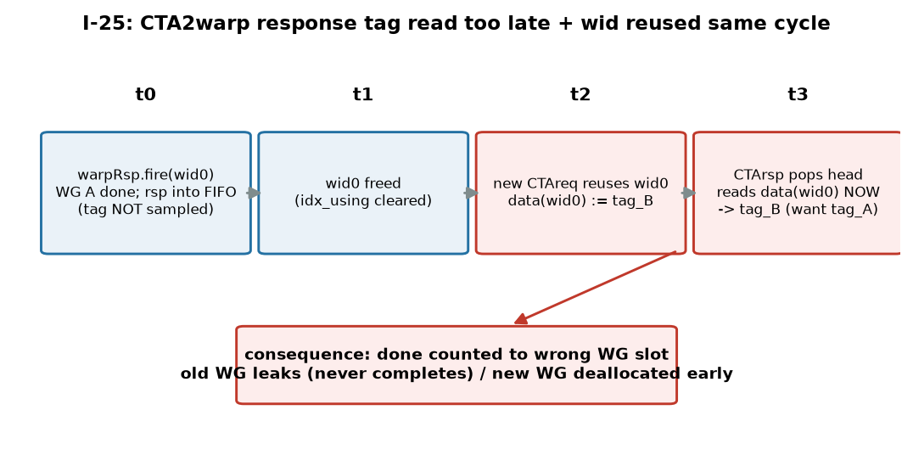

> English translation of the Chinese master `doc/bugs/I-25-完成响应tag迟读.md`. Translated 2026-09-13.

# I-25 Defect Detailed Analysis Report: CTA2warp completion-response tag late-read + same-cycle wid reuse → completion bookkeeping misattributed

| Item | Content |
|---|---|
| ID | I-25 |
| Source location | `ventus/src/pipeline/CTA2warp.scala:77` (`CTArsp.bits := data(fifo.head.wid)` combinationally late-reads `data` at dequeue time); linked sites `:63` (idx_using cleared in the same cycle as warpRsp.fire), `:64-66` (data overwritten in the same cycle as a new CTAreq.fire); downstream victim point `cta/cu_interface.scala:161` (looks up (cu, wg_slot) by tag) |
| Type | Functional bug (silent bookkeeping corruption) — "wid lifecycle" problem family |
| Severity | **High** (WG completion bookkeeping misattributed: the old WG never completes (slot/resources/host notification all leak), the new WG completes prematurely (resources reclaimed early and conflict with still-running warps)) |
| Confirmation status | 【Confirmed】, fixed version modeled and verified + ChiselSim reproduction succeeded + patch-tree regression turned green |
| Main evidence | [Lean machine-checked proof] T7 witness (tag 0x11≠0x08) + mechanism theorems + safety boundary + two downstream-consequence witnesses; [simulation run] ChiselSim reproduction (tag=0x11≠0x08, numerically identical to the Lean witness) + patch-tree regression 1/1 green; [direct source reading] CTA2warp.scala full 79 lines checked line by line |
| Lean model | `lean/Ventus/CTA/CTA2warp.lean` (mechanism and witness), `lean/Ventus/CTA/CuInterface.lean` (consequence closure); fixed version `lean/VentusF/Schedule.lean` (`fschC2w*`) |
| Repro/patch | `repro/CTA2warpTagBugRepro.scala` (ChiselSim, actually executed); patch `i25-cta2warp-tag-fifo.patch` (internal fix manifest; not released) (depends on the I-6 fix landing first) |
| Related entries | I-6 (warpRsp handshake violation, the other failure chain of the Queue(16) workaround; the I-25 mechanism is independent and does not need the FIFO to be full), I-5 (same-family bookkeeping defect), I-46 (same family: another consequence of same-cycle wid reuse), I-7 (same patch file i06-i07-i46 does not cover this entry) |

---

## 0. Abstract

CTA2warp is the interface-conversion module between the CTA scheduler and the warp
scheduler inside an SM: on dispatch it allocates a hardware slot wid to each warp
and records that warp's WF tag in the table `data(wid)`; when a warp finishes
(endprg), a completion response is buffered through a 16-entry FIFO and reported to
cu_interface, and the tag carried by the response is used to look up which warp of
which work-group (WG) has completed.

The defect is: **the FIFO stores only the wid; the tag is read combinationally from
`data(head-of-queue wid)` only when the response dequeues** (CTA2warp.scala:77), while
the wid is cleared from the occupancy bitmap `idx_using` in the very cycle of
warpRsp.fire (:63), and can be reused by a new CTAreq on the next cycle, overwriting
`data(wid)` (:64-66). Therefore, as long as a response stays in the FIFO for ≥2
cycles (the downstream cu_interface gather FSM needs ≥2 cycles to process each done;
during UPDATE/DEALLOC `cu_wf_done.ready=0` — **stays are the norm**), what the
dequeue reads is **the tag of the new warp that reused the slot**. cu_interface keeps
accounts by the wrong tag: the old WG's completion count is permanently short by 1
(it never completes — slots, resources, and host notification all leak), while the
new WG is over-counted by 1 (it completes prematurely — its resources are reclaimed
early and reallocated, conflicting with warps still running); a second form was also
found, the "residual-count amplifier": a polluted done hitting an idle slot leaves a
residue in wf_gather_cnt, causing a WG later assigned to that slot to be judged
complete prematurely.

This entry belongs to the "wid lifecycle bookkeeping" problem family of I-5/I-6, but
its mechanism is independent (it does not need the FIFO to be full). The evidence
chain is fully closed: Lean mechanism theorems + a concrete witness (tag
0x11≠0x08) + two downstream-consequence witnesses (cuifTi25Leak/cuifTi25Res) + a
safety-boundary theorem (consumption within one cycle is necessarily correct) +
ChiselSim reproduction (measured tag=0x11≠0x08, numerically identical to the Lean
witness) + a fix patch passing 1/1 green in the 38-patch merged-tree regression. The
fix semantics (sample the tag at enqueue time) has been proved in the Lean
fixed-version model.

---

## 1. Module Function and Design Intent

### 1.1 Background Concepts

- **WG/WF/warp**: the host submits work to the GPU in units of work-groups (WG);
  each WG contains several wavefronts (WF, i.e., warps, 32 threads executing in
  lockstep). The CTA scheduler (cta_scheduler) is responsible for splitting a WG
  into warps and dispatching them to SMs one by one.
- **wid and slot bookkeeping**: an SM has a fixed number (num_warp=8) of hardware
  warp slots. CTA2warp records which slots are in use with an occupancy bitmap
  `idx_using` (8 bits), and finds a free slot with `PriorityEncoder(~idx_using)`;
  `data` is an 8×6-bit register table recording the WF tag currently carried by
  each wid.
- **WF tag**: 6 bits, laid out as `{wg_slot_id(3b), wf_id(3b)}`; it is the key to
  completion bookkeeping — after receiving a completion response, cu_interface
  takes the (cu number, WG slot number) from the tag, increments the count for that
  WG in `wf_gather_cnt` by 1, and once num_wf responses have been collected, judges
  the WG complete (reclaims resources, notifies the host).
- **Queue(n) / Decoupled**: Chisel's standard FIFO and valid/ready handshake. Note
  that the warpRsp upstream (warp_schedule.scala:55) is a single-cycle pulse and
  does not wait for ready — this is I-6, and the `Queue(io.warpRsp, 16)` in
  CTA2warp is precisely the workaround built for it (the source :71-74 carries a
  TODO comment and an assertion).

### 1.2 Design Intent

- Dispatch (CTAreq.fire): allocate a free wid, set the bit in `idx_using`, write
  `dispatch2cu_wf_tag_dispatch` into `data(wid)`, and at the same time send a
  warpReq to the warp_scheduler.
- Completion (warpRsp.fire): clear the corresponding bit of `idx_using` (the slot
  becomes reusable immediately) and enqueue the wid into the FIFO; on FIFO
  dequeue, report `cu2dispatch_wf_tag_done = data(head-of-queue wid)`.

The design intent is clearly "report which WG/WF the completed warp belonged to."
A correct implementation requires the binding between tag and wid to be **held from
enqueue to dequeue** — either the FIFO stores the tag itself, or the wid is
guaranteed not to be reused before the response dequeues. Neither holds; that is
this entry.

---

## 2. Construct-by-Construct Reading of the Original Code

**Construct 1: wid is cleared in the same cycle as warpRsp.fire**
(`CTA2warp.scala:63`, ★ hazard point one):

```scala
idx_using:=(idx_using | ((1.U<<idx_next_allocate).asUInt & Fill(num_warp,io.CTAreq.fire))) & (~((Fill(num_warp,io.warpRsp.fire)).asUInt & ((1.U<<io.warpRsp.bits.wid)).asUInt)).asUInt
```

In the cycle of warpRsp.fire, the response has only just entered the FIFO, and the
occupancy bit of that wid is already cleared — on the next cycle
`PriorityEncoder(~idx_using)` can hand it to a new warp.

**Construct 2: data is overwritten in the same cycle as the new dispatch**
(`CTA2warp.scala:64-66`, ★ hazard point two):

```scala
when(io.CTAreq.fire) {
  data(idx_next_allocate):=io.CTAreq.bits.dispatch2cu_wf_tag_dispatch
}
```

At the same time as the new warp reuses the wid, the new tag overwrites `data(wid)`.
The `data` table has **no RegInit** (:57); safety depends entirely on the
"dispatch before use" discipline (noted in report 03).

**Construct 3: the tag is late-read at dequeue time**
(`CTA2warp.scala:71-78`, ★ the core hazard):

```scala
// TODO: Fix warp_scheduler warpRsp IO logic, which always requires ready=1
// WorkAround: warp_scheduler requires io.wrapRsp.ready=1, use a large enough FIFO to satisfy it temporarily
val CTArsp_fifo = Queue(io.warpRsp, 16)                               // ★ the FIFO stores only the wid
assert(io.warpRsp.ready, "warpRsp port requires ready=1, this FIFO is used to satisfy it, but not enough")

CTArsp_fifo.ready := io.CTArsp.ready
io.CTArsp.bits.cu2dispatch_wf_tag_done := data(CTArsp_fifo.bits.wid)  // ★ at dequeue, combinationally reads the "current" data(head-of-queue wid)
io.CTArsp.valid := CTArsp_fifo.valid
```

What is enqueued is the wid (`warpRspData` has only the wid field, :41-43); the tag
is looked up in `data` only in the dequeue cycle. Constructs 1 + 2 + 3 together:
while the response is staying in the FIFO, the wid is reused and overwritten, and
what the dequeue reads is the tag of the new warp.

**Why staying is the norm**: the downstream cu_interface gather FSM (the
GET_WF/UPDATE/DEALLOC three states of cu_interface.scala:142-146) needs at least
GET_WF (issue a RAM read) + UPDATE (write back the count) — two cycles — to process
each done; during UPDATE/DEALLOC `cu_wf_done.ready=0` — CTArsp backpressure of ≥2
cycles is the normal operating condition, not a corner case.

**Contrast: the dispatch path itself does not have this problem**: `warpReq.bits`
is combinationally passed through in the CTAreq.fire cycle (:67-69); wid and tag are
paired and sent in the same cycle, without a cross-cycle read of the data table (an
important negative conclusion discharged as `dcg3_wba1_capstone` in Discharge3).

---

## 3. Defect Analysis



### 3.1 Precise Description of the Defect

Trigger sequence (consistent with the Lean witness T7 and the ChiselSim
reproduction case):

1. A warp of WG A is dispatched to wid0, `data(0) = 0x08` (A's tag, wf_tag =
   {slot 1, wf 0});
2. That warp executes endprg, warpRsp.fire: wid0 enters the FIFO and
   `idx_using(0)` is cleared in the same cycle; CTArsp is backpressured (the stay
   begins);
3. On the 2nd cycle of the stay, a new CTAreq from WG B reuses wid0,
   `data(0) := 0x11` (B's tag, {slot 2, wf 1});
4. The CTArsp is dequeued and consumed: `cu2dispatch_wf_tag_done = data(0) =
   0x11 ≠ 0x08` — **A's completion is booked to B**.

Consequence chain (downstream cu_interface, takes (cu, wg_slot) by tag,
cu_interface.scala:161):

- **The old WG (A) never completes**: `wf_gather_cnt` is permanently short by 1,
  `wf_gather_finish` never holds → the slot `live` bit stays forever, resources are
  never reclaimed, the host never receives a completion notification (a **triple
  leak**);
- **The new WG (B) completes prematurely**: over-counted by 1, deallocated early —
  its resources are reclaimed and reallocated to a third WG, conflicting with B's
  still-running warps (cross-WG resource overlap);
- **Second form (residual-count amplifier)**: if the polluted done hits an **idle**
  slot, `wf_gather_cnt` retains a nonzero residue — the `splitter_load_new` load at
  cu_interface.scala:131-136 writes only info/valid and **does not clear
  wf_gather_cnt** — a WG C later assigned to that slot needs only num_wf−1 real
  dones to be judged complete prematurely. Side effect: in the UPDATE cycle the
  live write is unconditional, so a done hitting an idle slot turns it into a
  "ghost resident" (under DEBUG the assertion at cu_interface.scala:191 fires
  first; after synthesis it is silent).

### 3.2 Root Cause

The snapshot semantics of "enqueue stores the wid, dequeue looks up the table" is
wrong: the `data` table is **mutable bookkeeping** (reusing a wid overwrites it),
while FIFO consumption is **delayed** — the snapshot must be sampled in the enqueue
cycle, not looked up live in the dequeue cycle. This is a typical "cross-cycle
consistency" defect: each of the three constructs looks reasonable on its own
(releasing slots early improves reuse; the data table updates with dispatch;
looking up the table at dequeue saves FIFO width), but combined they break the
temporal consistency of the tag↔warp binding. The TODO/assertion shipped in the
source (:71-74) shows the author already knew the warpRsp interface was problematic
(I-6), but the late-read defect is unrelated to the workaround — it was introduced
independently.

### 3.3 Harm and Tolerability

- **Harm**: corrupted WG completion bookkeeping is a system-level failure — on the
  host side some WGs never return (hang) while others return early with their
  resources already misappropriated (data race). No trap, no assertion (after
  synthesis) throughout — silent.
- **Trigger condition**: CTArsp backpressure ≥2 cycles (the norm) + a re-dispatch
  of the same wid within the stay window. Reachable under multiple WGs with densely
  interleaved warp lifecycles; unreachable for a toy kernel with a single WG and a
  single warp — this explains why upstream testing did not expose it.
- **Tolerability**: genuinely triggerable under the current configuration (CTA2warp
  is on the completion path of every warp). Rating: **high**.
- **Note**: this entry shares the same Queue(16) workaround with I-6 (responses
  dropped when the FIFO is full), but the trigger conditions differ (no full FIFO
  needed) and the consequences differ (mis-booking vs losing the account); both
  fixes point to "restructuring the response path," and the patches are merged
  (i25 depends on i06 landing first).

---

## 4. Lean Formal Evidence

All proofs have zero sorry and the full build passes; the `#print axioms` audit at
the file tail is archived (bv_decide theorems carry per-theorem private LRAT trust
axioms; native_decide tests additionally carry the `Lean.ofReduceBool` family).

**Mechanism layer** (`lean/Ventus/CTA/CTA2warp.lean`):

- `c2wOut_tag_cons` (rfl-level): the dequeued response carries the **current**
  `data(head-of-queue wid)`, not the tag written when that warp was allocated —
  this pins the late-read semantics of :77 as a first-class fact and is the
  foundation of all consequence analysis;
- `c2w7_tag_safe_next_cycle` (two-cycle manual reasoning): the **safety
  boundary** — a response consumed within one cycle of enqueue is necessarily
  correct (a new allocation in the enqueue cycle writes a different slot, given the
  premise `c2w1_alloc_rsp_no_clash` "the response wid is registered"; a write on
  the next cycle takes effect only on the cycle after). Together with the witness,
  "when it goes wrong and when it does not" is fully closed;
- T7 witness (anonymous example, native_decide): after A's (tag=0x08) warp finishes
  on wid0, the response stays; wid0 is reused by B (tag=0x11); at consumption
  `ctaRspTag = 0x11 ≠ 0x08`; the control (T7s2, consumed after a 1-cycle stay) has
  tag=0x08 correct — a stay of ≥2 cycles is the exact dividing line.

**Consequence closure** (`lean/Ventus/CTA/CuInterface.lean`, native_decide
trace witnesses):

- `cuifTi25Leak`: the polluted done causes B (slot5) to be deallocated with zero
  completions (resources reclaimed early), while A (slot2) has `cntMem=1≠2` and its
  live bit stays forever (slot/resources/host notification all leak) — the original
  consequence chain of report 03 is machine-confirmed;
- `cuifTi25Res` (residual-count amplifier): the polluted done hits idle slot 7 →
  `wf_gather_cnt` retains 1 (loadNew does not clear cnt) → a WG C (numWf=2) later
  assigned to that slot finishes after only 1 real done and is deallocated early.

**Contract view** (`lean/Ventus/Spec/Contracts.lean` registry): all H-CUIF-*
discharge theorems of cu_interface take CuifEnvOk as a premise, whose E2 "the tag
of a done points to a resident slot" is **exactly the premise broken by I-25**
(gap G4) — the correctness conclusion of `cuifInv_run` does not cover the I-25
scenario. CTA-E2 is the only one of the registry's 17 axiomatic contracts actually
broken by a counterexample.

**Fixed version** (`lean/VentusF/Schedule.lean`, fixing is verifying):
`fschC2w_enq_tag_sampled` (the tag is sampled at enqueue), `fschC2w_no_late_read`
(the dequeue tag is independent of the current data table — the late-read path is
eradicated), `fschC2wT_i25_tag_correct` (the original T7 witness turns green on the
fixed version).

---

## 5. Simulation Verification (ChiselSim run + patch-tree regression)

**ChiselSim module-level reproduction** (`repro/CTA2warpTagBugRepro.scala`, 99
lines, actually run 2026-09-07, doc/22): after warp0 (tag=0x08) executes endprg,
backpressure CTArsp for ≥2 cycles and re-dispatch the same wid (tag=0x11); measured
`cu2dispatch_wf_tag_done = 0x11` (expected 0x08) — **reproduction succeeded**, and
it is **numerically identical** to the Lean witness (CTA2warp.lean T7) (listed in
doc/22's "comparison with Lean model conclusions" section as one of the numerically
exact matches).

**Patch-tree regression** (38-patch merged tree, actually run 2026-09-10, doc/22):
pipeline.CTA2warpTagBugRepro **1/1 green** (the fix turns it green; it also
confirms that i25 coexists without regression with i16's new trap field and i47's
changes).

---

## 6. Upstream Impact Analysis

- **Trigger surface**: every multi-WG / multi-generation warp-reuse scenario (wid
  reuse is routine operation); CTArsp backpressure is structurally produced by the
  cu_interface gather FSM. This module sits on the completion path of every warp,
  with no downstream compensation point.
- **Why upstream did not find it**: existing tests are mostly single-WG, short-warp-
  lifecycle, or stop-on-completion scenarios, with no re-dispatch of the same wid
  within a stay window; moreover the error is at the bookkeeping layer (it does not
  affect intra-warp data) and can only be observed host-side as "WG not returned /
  returned early," which is easily mistaken for a scheduling anomaly.
- **Corroboration**: the TODO comment + assertion at source :71-74 prove the author
  already knew this interface region was fragile (I-6); the late-read defect here
  shares the same origin (the same workaround region) but holds independently.
- **Lesson for the verification effort**: this entry breaks the axiomatic contract
  CTA-E2 in the registry — "a downstream module's proved correctness holds only
  when the environment keeps its contract"; the value of contract discharge (the
  Discharge series) is precisely to make such premises explicit, so that I-25-class
  defects can be located exactly at the broken premise.

---

## 7. Fix Plan and Fix Verification

**Fix direction** (the internal fix manifest, functional fix required): the tag enters the FIFO
with the response (sample `data(wid)` at enqueue), instead of being late-read at
dequeue. **Depends on I-6 landing first** — once I-6 makes warpRsp a standard
Decoupled, the FIFO backpressures normally when full and the original TODO/assert
workaround can be removed along with it.

**Patch** (`i25-cta2warp-tag-fifo.patch` (internal fix manifest; not released)):

- New bundle `CTArspFifoEntry` (two fields: wid + tag);
- The FIFO now stores `CTArspFifoEntry`: enq.bits.tag samples
  `data(io.warpRsp.bits.wid)` in the enqueue cycle;
- Dequeue passes through `CTArsp_fifo.io.deq.bits.tag` directly, no longer looking
  up the `data` table;
- Removes the original workaround comment and assertion.

**Fix verification**:

- Effectiveness: Lean fixed-version theorems `fschC2w_enq_tag_sampled`/
  `fschC2w_no_late_read`/`fschC2wT_i25_tag_correct` (the original T7 witness turns
  green) + ChiselSim patch-tree regression 1/1 green;
- Regression safety: 38-patch merged-tree full regression shows no collateral
  damage (doc/22).
- **Incidental recommendation (not included in the patch)**: clear the
  corresponding `wf_gather_cnt` entry when cu_interface's `splitter_load_new`
  loads (zero cost), blocking the "residual-count amplifier" channel — even if
  another mis-booked done arrives, the residue will not propagate across WG
  generations.

---

## 8. Conclusion

| Evidence layer | Content | Strength |
|---|---|---|
| Direct source reading | CTA2warp.scala:63/:64-66/:71-78 checked line by line; downstream wiring at cu_interface.scala:161/:131-136 verified | All 79 lines, line by line |
| Lean machine-checked proof | `c2wOut_tag_cons` (mechanism) + T7 witness (0x11≠0x08) + `c2w7_tag_safe_next_cycle` (safety boundary) + `cuifTi25Leak`/`cuifTi25Res` (two consequence forms) | Mechanism at rfl level; witnesses at native_decide trace level |
| ChiselSim reproduction | tag=0x11≠0x08, numerically identical to the Lean witness | Actually run (doc/22) |
| Fix verification | i25 patch (sample tag at enqueue); Lean fixed version `fschC2w*` three theorems + patch-tree regression 1/1 green | Machine proof + actual run |

I-25 is an exemplar of the "cross-cycle consistency" defect class: the tag↔wid
binding holds in the enqueue cycle but has lapsed by the dequeue cycle; each
construct is reasonable on its own, and the combination goes wrong. It is also a
representative case of this project's "Lean witness and RTL reproduction matching
numerically" (0x11≠0x08 on both sides), and as the only counterexample in the
registry that breaks an axiomatic contract (CTA-E2), it directly delineates the
applicability boundary of all downstream H-CUIF-* discharge theorems.
