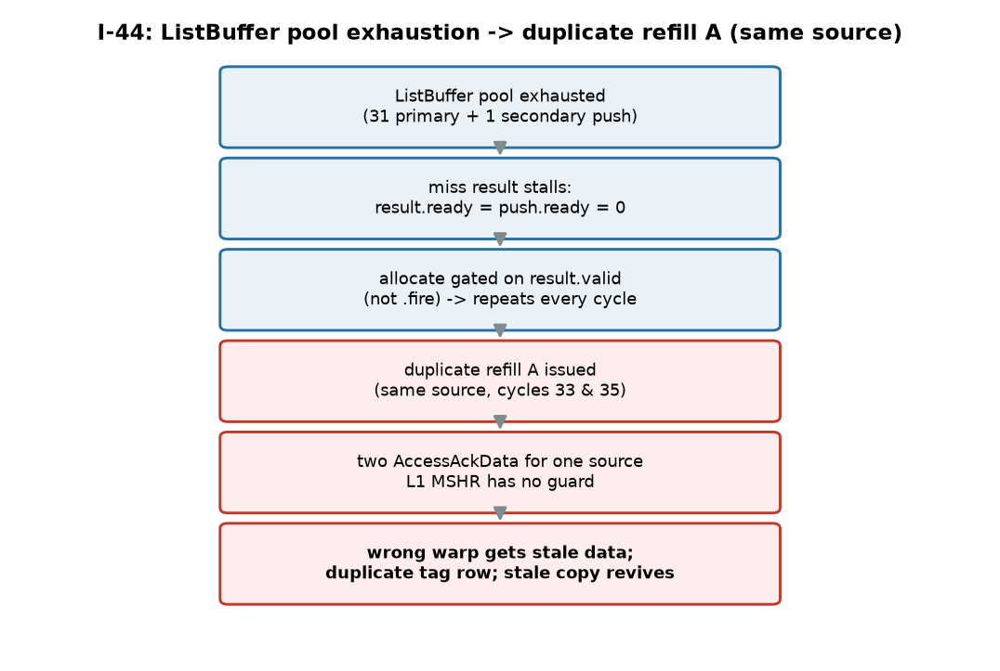

> English translation of the Chinese master `doc/bugs/I-44-池耗尽重复refill.md`. Translated 2026-09-13.

# I-44 Detailed Bug Analysis Report: L2 ListBuffer pool exhaustion × allocate gated on result.valid (not fire) — duplicate refill A on the same source

| Item | Content |
|---|---|
| ID | I-44 |
| Source location | `ventus/src/L2cache/Scheduler.scala:190` (★pitfall one: allocate gating uses the `result.valid` level instead of `result.fire`) × `:225` (read-issue gating `requests.io.push.ready` is checked one cycle earlier than the result beat) × `:217`/`:223` (push on the result beat; the secondary push of the tagMatches branch also consumes a freelist entry) × `:252` (miss result.ready = push.ready); downstream receiving side `L1Cache/DCache/DCache.scala:620` (allocateWrite has no entry-occupancy guard), `L1Cache/L1MSHR.scala` (the missRspIn guard only checks subentry non-emptiness) |
| Type | Functional bug — **correctness-level** (duplicate refill A on the same source ⇒ duplicate responses ⇒ downstream bookkeeping corruption / stale data) |
| Severity | **High** (correctness-level; the guardless path through L1/LSU downstream can amplify it into cross-warp stale data + tag/data array misalignment) |
| Confirmation status | 【Confirmed】, with a machine-checked proof of the E3 falsification chain; the fixed version has been modeled and verified (L2 root-cause fix + L1 hardening) + the i44 patch entered the 38-patch merged-tree regression |
| Main evidence | 【Lean machine-checked proof】`l2dc_e3_counterexample`/`l2dc_e3_falsified`/`l2dc_e3_inv1_broken`/`l2dc_lb_pool_exhausted`/`l2dc_e3_env_allocs`; downstream resolution `Ventus/Mem/DupRsp.lean` (C1–C4) and the full `Ventus/Mem/DupRspTag.lean` (R1–R7) family; 【direct source reading】line-by-line check of Scheduler.scala:180-252 |
| Lean model | `lean/Ventus/L2/Scheduler.lean`, `lean/Ventus/L2/Discharge.lean`, `lean/Ventus/Mem/DupRsp.lean`, `lean/Ventus/Mem/DupRspTag.lean`; fixed version `lean/VentusF/MemL2.lean` (`fmem_i44_*`) |
| Reproduction / patch | No ChiselSim suite (doc/22 does not cover the L2 Scheduler; ready-to-run (not executed in this environment)); patch `i44-l2-alloc-fire-l1-guard.patch` (internal fix manifest; not released) (three files: Scheduler + L1MSHR + DCache) |
| Related entries | I-39/I-41 (their "machine-proven unreachable" resolution depends on E3; this entry falsifies E3 and invalidates that resolution in that corner — the qualification has been written into the corresponding doc/03 entries), I-42/I-43 (same file, same wave), I-40 |

---

## 0. Summary

The L2 Scheduler's miss-allocation path has two independent gating defects, each
harmless on its own, whose combination produces a correctness-level consequence:

1. **The read-issue gating looks one cycle too early** (:225): `push.ready` is
   checked when the request is accepted, but the request actually lands in the
   requests queue (ListBuffer) one cycle later, on the directory result beat.
   During that one-cycle gap, a same-beat secondary push (a request merged into
   an existing entry — it occupies no new MSHR but does consume one ListBuffer
   entry-pool slot, :217/:223) can exhaust the pool.
2. **allocate is level-sensitive** (:190): the MSHR allocation gating uses
   `directory.io.result.valid` instead of `.fire` — when the result is stuck
   because push.ready=0 (result.ready=0, :252), allocate.valid repeats true on
   every beat, the same entry is repeatedly "re-allocated", and its
   sche_a_valid is repeatedly set ⇒ **refill A for the same source is issued
   to the outside world repeatedly** (witness: issued at beat 33 and beat 35,
   both with source=31).

The outer memory (TileLink discipline: exactly one D response per A) receives two
A requests with the same source ⇒ returns two AccessAckData with the same source.
When these two responses reach L1, the downstream resolution (§6) proves that
neither L1MSHR nor LSU/MSHRv2 has any "does this response belong to the current
occupant" guard, so a duplicate response can impersonate the genuine response of
a new occupant — **a load from another warp unrelated to this miss receives stale
data + the L1 tag/data arrays become misaligned**, with no layer of the chain
reporting any error.

This entry's methodological significance goes beyond itself: it **falsifies the
environmental assumption E3** ("allocate hit ⇒ push is accepted") — E3 was the
key premise of the wave-25 "machine-proven unreachable" resolution of I-39/I-41.
E3 does not hold in the ListBuffer pool-exhaustion corner (`l2dc_e3_falsified`),
I-39's invariant is broken in that corner (`l2dc_e3_inv1_broken`), and the
unreachability conclusions of I-39/I-41 are qualified as "valid only within the
range where E3 holds" (doc/03 revised accordingly). This is the flagship case of
the project principle "the assumptions of a proof must themselves pass proof
auditing".

---

## 1. Module Function and Design Intent

### 1.1 Background concepts

- **The Scheduler's two-beat pipeline**: sinkA receives a request → (beat 0, the
  read-issue beat) the directory read is issued and resources are checked at the
  same time → (beat 1, the result beat) the directory result flows out, and the
  Scheduler allocates the request into a free MSHR entry and pushes the request
  data into the requests ListBuffer.
- **ListBuffer (requests)**: a structure of 32 queues × a 32-entry pool. Each
  in-flight request occupies one queue (indexed by its MSHR entry number) and one
  **entry-pool** slot; the queues record request data for the later schedule.d
  (response to L1) and schedule.a (outbound data fetch). Key property: **both
  primary pushes (new misses) and secondary pushes (requests merged into an
  existing entry) consume the entry pool** — the latter just occupies no new
  queue. The pool has 32 slots; when exhausted, push.ready=0.
- **TileLink A/D discipline**: on the outer memory interface, every A-channel
  request (carrying a source number) corresponds to exactly one D-channel
  response (carrying the same source). Two A's with the same source = two D's —
  if the sender duplicates an A due to an internal defect, the receiver cannot
  detect the anomaly.
- **valid vs fire**: under Decoupled handshaking, `valid` is a level (data is
  available this beat) while `fire = valid && ready` is an event (data is
  consumed this beat). Using valid to gate a "one-shot action" is a classic
  pitfall: when data stalls, the action repeats every beat. This entry's
  allocate steps on exactly that mine.

### 1.2 Design intent

The intent of allocate is "on the result beat, allocate the miss to a free entry
once"; the intent of the read-issue gating is "don't issue the directory read if
resources are insufficient". Each looks reasonable on its own; together they miss
the race window where "resources may be consumed by a third party between the
issue beat and the result beat".

---

## 2. Line-by-Line Reading of the Original Code

**Construct one: read-issue gating (push.ready checked on beat 0)**
(`Scheduler.scala:225`):

```scala
directory.io.read.valid := request.valid && !(request.bits.opcode === Hint) && mshr_free && requests.io.push.ready && directory.io.ready && !(issue_flush_invalidate)
```

push.ready is checked on the **read-issue beat**; the request is actually pushed
on the **result beat** — one cycle apart.

**Construct two: the result-beat push — the secondary branch also consumes the
pool** (`:217`/`:223`):

```scala
requests.io.push.valid      := directory.io.result.valid && (!directory.io.result.bits.hit) && !directory.io.result.bits.flush   // :217
...
requests.io.push.bits.index := OHToUInt(Mux(alloc,mshr_insertOH,tagMatches))   // :223
```

When `alloc=0` (tagMatches has a match), the push lands on an **existing** queue
(secondary miss merge) — it occupies no new MSHR entry, but does consume one
ListBuffer entry-pool slot.

**Construct three: allocate gating uses result.valid (★pitfall one)**
(`:187-190`):

```scala
(mshr_insertOH.asBools zip mshrs) map { case (s, m) =>{
  m.io.allocate.valid:=false.B
  ...
  when (directory.io.result.valid && alloc && s && !directory.io.result.bits.hit && !directory.io.result.bits.flush){   // :190 ★
    m.io.allocate.valid := true.B
    ...
```

Level-sensitive: allocate.valid repeats for as many beats as result.valid stays
asserted.

**Construct four: miss result.ready = push.ready (★pitfall two, same location as
I-43)** (`:252`):

```scala
directory.io.result.ready:= Mux(directory.io.result.bits.hit,dir_result_buffer.io.enq.ready,requests.io.push.ready)
```

Pool exhausted (push.ready=0) ⇒ the miss result **is not consumed** (the result
stalls and valid stays asserted) — combined with construct three: allocate
repeats every beat.

**Construct five (MSHR side): allocate arms the pending A** (`MSHR.scala:113-115`):

```scala
when(io.schedule.a.fire) {
  sche_a_valid := false.B
}.elsewhen(io.allocate.valid) {
  sche_a_valid := true.B      -- every allocate re-arms it
}
```

Every repeated beat of allocate sets sche_a_valid once more; one beat after the
A fires it is armed again ⇒ the A for the same source (= entry number) is issued
repeatedly.

---

## 3. Bug Analysis



### 3.1 Precise description of the defect (the E3 falsification chain)

Environmental assumption E3 (a convention made when modeling the Scheduler):
"allocate hit ⇒ push is accepted". The argument for its "obvious truth" used to
be: the read-issue gating already gates on `mshr_free && push.ready` (:225), only
one directory result is in flight, and from then on the pool only shrinks. **What
was missed**: the secondary push consumes a pool slot on the result beat, and the
read-issue gating cannot see a secondary push one cycle later.

Complete trigger sequence (the shape of the machine-checked witness trace):

1. Beats 0..30: 31 primary Get misses allocate entries 0..30 in turn, each
   entry's A is issued and discharged — 31 entry-pool slots are used, only 1
   slot remains free;
2. Beat 31: the result of a secondary miss (matching entry 0) flows out, and the
   push lands on queue 0 — **exhausting the entry pool**; on the same beat the
   read-issue gating sees push.ready=1 (the last beat before exhaustion is still
   1) and passes, so the directory read of a new Get miss is issued;
3. Beat 32: the new miss's result flows out — allocate hits entry 31 (the only
   free bit of insertOH), but push.ready=0 ⇒ the result is not consumed
   (it stalls);
4. After beat 32: entry 31 is armed (scheAValid=1) but valids(31)=0 (the push
   never landed); the result keeps valid ⇒ allocate repeats every beat ⇒
   scheAValid is set repeatedly;
5. Beats 33 and 35 each issue one A (same entry ⇒ same source=31) — **duplicate
   refill A**.

### 3.2 Root cause

The combination of two gating defects (each harmless in isolation):

- If allocate were gated on fire: when the result stalls, allocate happens only
  once and there is no duplicate A;
- If the read-issue gating reserved one slot for the secondary push (push.ready
  changed to "free ≥ 2"): the pool would provably not be exhausted on the result
  beat, the push would provably be accepted, and E3 would hold;
- The current code has neither, and the race window = "a secondary push happens
  to exhaust the last slot between the issue beat and the result beat".

Root cause in one sentence: **a counting mismatch between cross-beat resource
reservation and cross-module resource consumption (primary and secondary share
the entry pool)**.

### 3.3 Harm and tolerability

- **Direct harm (inside L2)**: the outer memory receives two A's with the same
  source ⇒ two AccessAckData with the same source ⇒ L2 MSHR bookkeeping
  corruption (the I-41 family's allocate×sinkd / merge×sinkd collisions become
  reachable again in this corner — the wave-27 revision qualification of doc/03
  I-41).
- **Downstream amplification (L1/LSU, end-to-end machine proof in §6)**: when the
  duplicate response reaches L1 — if the entry has not been reused, it degrades
  to transient backpressure (a sticky stall); if the entry has been reused,
  **there is no guard**: the duplicate response issues a coreRsp with the **new
  occupant's** metadata but carries the old block's data as payload (silent data
  corruption), and the L1 tag array becomes misaligned, with duplicate tag lines
  in one set, eventually resurrecting a stale copy (correctness-level).
- **Tolerability**: triggering requires high L2 churn (31+ in-flight requests)
  combined with a secondary merge — a normal high-load condition; intolerable,
  rated: high.

---

## 4. Lean Formal Evidence

All machine-checked (zero sorry). File: `lean/Ventus/L2/Discharge.lean` §3
(:271-390). The witness family uses native_decide; the proposition falsification
and environment legality are symbolic theorems.

### 4.1 ListBuffer leg: pool exhaustion is reachable

**`l2dc_lb_pool_exhausted`** (Discharge.lean:291, native_decide): after 31
primary pushes (queues 0..30) + 1 secondary push (queue 0) —

- `lbPushReady l2dcLbPrim = true` (on the last beat before exhaustion push.ready
  is still 1, so the read-issue gating passes on that beat);
- `l2dcLbFull.used = BitVec.allOnes 32` (entry pool exhausted);
- `l2dcLbFull.valid.getLsbD 31 = false` (**queue 31 is still free** — i.e. MSHR
  entry 31 is unused, so allocate has a free slot to hit);
- `lbPushReady l2dcLbFull = false` (from then on push.ready=0).

This leg nails the core counter-intuitive point of the trigger: **a free MSHR
entry and an exhausted ListBuffer pool can hold simultaneously** (a secondary
push consumes the pool but not an MSHR).

### 4.2 Scheduler leg: the counterexample and the duplicate A

Pre-state `l2dcE3Pre` (hand-constructed: entries 0..30 allocated, A's already
issued, valids=0x7FFFFFFF — only entry 31 free). Counterexample input
`l2dcE3CexIn`: a new Get miss result (tag=100, no match) + pushReady=0.

**`l2dc_e3_counterexample`** (Discharge.lean:354, native_decide):

- Beat 32: `l2scAllocValid l2dcE3Pre l2dcE3CexIn 31 = true` (allocate hits entry
  31) ∧ `pushReady = false` — E3's antecedent holds while the consequent fails;
- After beat 32: entry 31 is armed (scheAValid=1) but valids(31)=0 (the push
  never landed);
- **Beats 33 and 35 each issue one A** (`l2scAFire ... 31 = true` ×2, same
  source=31) — the duplicate A is established.

**`l2dc_e3_falsified`** (Discharge.lean:367, symbolic theorem): E3 as the
proposition `¬(∀ i, allocValid i → pushReady)` — does not hold under the
pre-state l2dcE3Pre and input l2dcE3CexIn.

**`l2dc_e3_inv1_broken`** (Discharge.lean:377, symbolic theorem):
`¬ l2scInv1 l2dcE3St33` — I-39's invariant (ListBuffer free slot ⇒ no pending A)
is broken in this corner (valids(31)=0 while scheAValid(31)=1). The
"machine-proven unreachable" resolution of I-39/I-41 depends on E3 and fails in
this corner (doc/03 has been qualified).

**`l2dc_e3_env_allocs`** (Discharge.lean:387, symbolic theorem): the allocate
trace of the first 31 beats has a legal environment on every beat (E1 vacuous —
no sinkd; E3 — pushReady=1). I.e. "the first 31 beats are entirely legal and E3
only fails on beat 32" — the failure lies in the spec itself, not in the trace
construction.

### 4.3 Evaluation-explosion degradation (methodological record, marked as-is)

The full trace of the E3 counterexample is 36 beats long (31 primary + 1
secondary + 4 consequence beats). **A 36-beat runTrace + native_decide measured
a >600s timeout** (a recurrence of the known whole-machine evaluation explosion
on multi-beat traces, Discharge.lean Q2⑤). Degradation scheme (Q2⑤, approved by
the briefing):

1. The ListBuffer leg independently machine-proves pool exhaustion (§4.1, pure LB
   model, no Scheduler state);
2. On the Scheduler side, start from the **hand-constructed pre-state**
   `l2dcE3Pre` and step numerically for ≤3 beats only (l2dcE3St33/34/35 stepping
   beat by beat through `l2scStep`);
3. The pre-state's reachability is connected via **symbolic theorems**:
   `l2dc_e3_env_allocs` machine-proves that the 31-beat primary allocate sequence
   has a legal environment on every beat, and the LB leg machine-proves that the
   pool state evolves consistently with the same sequence (the argument aligning
   the valids shadow with the LB valid bits is in the comments at
   Discharge.lean:331-337).

After degradation, building the single file (containing 3 multi-beat witness
theorem families) takes about 340s (Q2⑤ notes this is still on the slow side).
**Honest boundary**: the 31-beat prefix is not numerically replayed as a whole;
the pre-state's reachability is supported by a three-part structure — "LB-leg
machine proof + per-beat symbolic environment theorem + manual connecting
comment" — not by a single native_decide.

### 4.4 Axiom audit

`#print axioms` archived at the end of Discharge.lean: the witness family
(`l2dc_i42_witness`, `l2dc_i43_witness`, `l2dc_lb_pool_exhausted`,
`l2dc_e3_counterexample`, etc.) carries the `_native.native_decide.ax_*` trust
axioms (the expected form for the Lean 4.31 toolchain); the symbolic theorems
(`l2dc_e3_falsified`, `l2dc_e3_env_allocs`, `l2dc_e1_step`, etc.) rely only on
propext/Quot.sound-level axioms.

---

## 5. Simulation Verification

**Ready-to-run (not executed in this environment).** Neither doc/22's ChiselSim
channel (11 suites) nor its Verilator channel (10 kernels) contains an L2
Scheduler-level suite; I-44 has no RTL reproduction case.

Indirect evidence: the **38-patch merged-tree regression** (2026-09-10, doc/22) —
the merged tree containing the i44 patch (modifying three files: Scheduler.scala
+ L1MSHR.scala + DCache.scala) compiles under mill (MILL_EXIT=0), and all
regression-suite verdicts agree with the 35-patch tree (no collateral damage).
This is patch-regression safety evidence, not an RTL reproduction of the bug.

Suggested reproduction (ready to write): a directed ChiselSim test at the L2
Scheduler level — first exhaust the ListBuffer pool with 31 primary + 1
secondary (the LB-leg trace can be ported directly), then issue a new Get miss
and observe the A with source=31 appearing twice on the sourceA channel.

---

## 6. Upstream Impact Analysis (downstream resolution: what happens after the duplicate response reaches L1)

The "duplicate AccessAckData on the same source" produced by I-44 travels along
the response channel to L1 (DCache). Two dedicated files machine-prove the
end-to-end consequence chain link by link (resolved 2026-08-30).

### 6.1 L1MSHR / MSHRv2 layer (`lean/Ventus/Mem/DupRsp.lean`)

Interface fact (re-checked against the Chisel source, DupRsp.lean file header):
the duplicate response's d_source is **bit-identical** to the genuine response's
(DCache.scala:616-617, instrId = high bits of d_source); L1MSHR's
missRspIn.ready is the only "is this response expected" check on the chain, and
it only checks subentry-row non-emptiness (used≠0), **with no ownership check**
(`dbr_l1m_guard_exact`: guard = rspIn.valid ∧ used≠0, rfl-level).

- **C1 (orphan response, entry released but not yet reused)**: absorbed, produces
  no coreRsp (`dbr_l1m_orphan_no_coreRsp`), and the bookkeeping tables are not
  polluted (`dbr_l1m_orphan_tables_kept`); **but there are two non-transparent
  side effects**: (a) `releasing_stall` is toggled on
  (`dbr_l1m_orphan_stall_toggle`) — DCache.scala:217 uses it to block coreReq,
  a sticky backpressure until the next response on the same entry drains it
  (witness `dbrW1_sole_effect_stall`); (b) statusR is advanced as if by a genuine
  response (`dbr_l1m_orphan_statusR`, a conservative direction).
- **C2 (entry reused: the entry is given to a new miss between the two
  responses)**: **no guard** — `dbr_l1m_reused_consumed` (symbolic theorem: when
  the entry is non-empty, any response carrying that entry number is treated as
  genuine, immediately issuing a coreRsp with the **current occupant's**
  ti/blockAddr and clearing the subentry). Witness `dbrW2_dup_emits_B_coreRsp`:
  the duplicate response drives a coreRsp for new block B (ti/ba all legitimate,
  undetectable downstream), but the coreRsp data = the duplicate response's
  payload = old block A's data (DCache.scala:693 payload passthrough); when B's
  genuine response later arrives, the entry is already empty, and it degenerates
  into an orphan that is silently absorbed (`dbrW2_genuine_orphaned`). **Silent
  data corruption (correctness-level)**.
- **C3 (MSHRv2/LSU consumer side)**: equally guardless (`dbr_mshr_no_guard`:
  from_dcache.ready = state==s_idle; the check `&& used.orR` for "is this instrId
  in flight" is commented out — pipeline/MSHR.scala:45). Witness
  **`dbrW3_dup_premature`**: warp5's new load entry is **completed early with
  warp2's stale response data and written back to the register file** (output
  data 0xAAAA0000/0xBBBB1111 = A's old payload); when warp5's genuine response
  arrives it is first blocked by the sticky stall for one beat, then absorbed as
  an orphan (`dbrW3_genuine_blocked`/`dbrW3_genuine_orphan`).
- **C4 (end-to-end closure)**: I-44 trigger × L1 guardless × LSU guardless ⇒
  **an unrelated warp receives stale data + L1 tag/data array misalignment**, with
  no layer of the chain reporting an error. When the entry is not reused it
  degrades to C1 (transient backpressure). The trigger window = the entry being
  released and reused within the interval between the two responses (the I-44
  witness's two A's are 2 beats apart; under 4-entry high churn the window is
  non-zero).

### 6.2 TagAccess-level residual-risk ruling (`lean/Ventus/Mem/DupRspTag.lean`, harmful)

Orphan/duplicate responses also drive allocateWrite/dataFill via
DCache.scala:620 (that enable **does not include** the L1MSHR used≠0 guard;
nailed at rfl/enumeration level by `dbt_orphan_allocV`/`dbt_orphan_datafill`).
Ruling conclusions (R1–R7):

- **R2 (idempotence criterion)**: the dup's array write is harmless ⟺ on the dup
  beat the replacement selection still points at the genuine one's way and the
  content is unchanged (`dbt_fill_idempotent_of_same`).
- **R3 (the "idempotent if no new miss" conjecture fails)**: the genuine fill
  itself sets way_valid (L1TagAccess.scala:314) ⇒ when the set is not full, the
  dup's PriorityEncoder selection **must differ from** the genuine one's way
  (`dbt_notfull_dup_way_diff`, full enumeration of way=2 by bv_decide) ⇒ the
  same tag and same data get installed into a second way = **a duplicate tag is
  installed** (witness `dbtW1_dup_installed`: two ways with the same tag and same
  valid) — exactly the state that the commented-out `PopCount(waymask)<=1`
  assertion at L1TagAccess.scala:408 was meant to guard against.
- **R4 (duplicate tag is non-transparent but currently masked by two layers of
  coincidence)**: probing yields a two-hot waymask
  (`dbt_dup_twohot`/`dbt_dup_hit_reads_dup_copy`); (a) OHToUInt=Log2 always
  selects way1 (the dup copy), so hit reads/writes/set-dirty all go to way1, and
  the stale way0 is temporarily invisible; (b) the write-hit timestamp refresh
  uses the raw two-hot waymask ⇒ the two copies' timestamps are forever tied
  (`dbt_storeHit_times_tie`).
- **R5 (harmful witness, correctness-level)**: when the set is full and the
  timestamps are tied, minIdxTree's tie-break evicts **way1**
  (`dbt_tie_evicts_way1`, bv_decide) — exactly the dup copy holding the new data.
  Trace W1→W4: the dup copy (new data) is evicted and written back to L2 (the
  data leaves through the correct write-back flow), **the stale way0 copy is
  resurrected as the unique match**, and subsequent reads of A hit and return
  **stale data** (main witness `dbtW_stale_read_contrast`: with the dup, the read
  returns dbtDatA (old); in the no-dup control group it returns dbtDatA2 (new) —
  the only difference = whether I-44's duplicate response arrives). Silent data
  staleness, with no error reported anywhere in the chain.
- **R6 (collateral harm)**: during the dup, the set's effective capacity is
  halved (`dbtW_capacity`).

### 6.3 Related-entry qualifications (ripples of the E3 falsification)

- **I-39** (allocate×a.fire priority inversion): its "machine-proven
  unreachable" resolution depends on `l2sc_inv1_preserved` ← E3;
  `l2dc_e3_inv1_broken` machine-proves that this invariant is broken in the
  pool-exhaustion corner. doc/03 I-39 has been revised to "the conclusion remains
  valid within the range where E3 holds; the resolution does not hold in the
  pool-exhaustion corner".
- **I-41** (allocate×sinkd / merge×sinkd): its resolution depends on E1, and the
  residual premises of E1's establishment (`l2dc_e1_step`/`l2dc_e1_run`) include
  per-beat E3; in the corner where E3 fails (duplicate A ⇒ duplicate
  AccessAckData), E1b can be broken at the same time, making the collisions
  reachable again (the wave-27 revision qualification of doc/03 I-41).

---

## 7. Fix Proposal and Fix Verification

**Patch** (`i44-l2-alloc-fire-l1-guard.patch` (internal fix manifest; not released), three
files, two-layer defense: L2 root-cause fix + L1 hardening):

1. **L2 root-cause fix** (`Scheduler.scala:190`): allocate gating `result.valid`
   → `result.fire` — when the result stalls, allocate happens only once (on the
   fire beat), cutting off the duplicate A at its source. (Alternative: change
   the read-issue gating's push.ready at :225 to "free ≥ 2" to reserve a slot
   for the secondary push — not adopted in the patch; the fire gating is more
   direct.)
2. **L1 hardening** (`L1MSHR.scala` + `DCache.scala`): L1MSHR gains a new output
   `missRspInEntryValid := entry_valid(missRspIn.bits.instrId)`; the
   allocateWrite.valid at DCache.scala:620 is conjoined with this occupancy guard
   — orphan/duplicate responses (entry released but not yet reused) no longer
   write the tag/data arrays. The patch comments honestly mark the residual risk:
   when the entry has been **reused** by a new miss, used≠0 cannot distinguish
   (the C2 case, which the L2 root-cause fix must cover).

**Fixed-version modeling verification** (【Lean machine-checked proof】):

- L2 root-cause fix (`lean/VentusF/MemL2.lean`): `fmem_i44_alloc_imp_fire`
  (fixed-version allocate ⟹ fire, symbolic theorem),
  `fmem_i44_e3_by_construction` (E3 holds by construction in the fixed version),
  `fmem_i44_e3_witness_green` (the original counterexample trace turns green),
  `fmem_i44_regress` (regression safety);
- L1 hardening (`lean/Ventus/Mem/DupRspTag.lean`): `dbt_fix_orphan_noop` — after
  the fix, an orphan response (used=0) performs zero array writes;
- Additionally recommended: restore the `PopCount(waymask)<=1` assertion at
  L1TagAccess.scala:408 as online detection (R3 proves the state it guards
  against is genuinely reachable).

**Patch-tree regression**: i44 is in the 35/38-patch merged tree (doc/22); all
merged-tree regression-suite verdicts agree, with no collateral damage
【simulation run · regression level】.

---

## 8. Conclusion

| Evidence layer | Content | Strength |
|---|---|---|
| Direct source reading | Line-by-line check of Scheduler.scala:187-190 / :217 / :223 / :225 / :252, MSHR.scala:110-115 | Both source files consistent |
| Lean machine-checked proof (trigger chain) | `l2dc_lb_pool_exhausted` (pool exhaustion reachable) + `l2dc_e3_counterexample` (duplicate-A witness) + `l2dc_e3_falsified` (E3 falsified) + `l2dc_e3_inv1_broken` (I-39 invariant broken) + `l2dc_e3_env_allocs` (first 31 beats' environment legal) | witness + symbolic theorems |
| Lean machine-checked proof (downstream resolution) | DupRsp.lean: `dbr_l1m_guard_exact`/`dbr_l1m_orphan_stall_toggle`/`dbr_l1m_reused_consumed`/`dbrW2_dup_emits_B_coreRsp`/`dbr_mshr_no_guard`/`dbrW3_dup_premature`, etc.; DupRspTag.lean: `dbt_notfull_dup_way_diff`/`dbt_tie_evicts_way1`/`dbtW_stale_read_contrast`/`dbt_fix_orphan_noop`, etc. | end-to-end closure |
| Fix verification | L2 root-cause fix `fmem_i44_alloc_imp_fire`/`fmem_i44_e3_by_construction`/`fmem_i44_e3_witness_green`/`fmem_i44_regress`; L1 hardening `dbt_fix_orphan_noop`; the i44 patch entered the 38-patch merged-tree regression with no collateral damage | machine proof + regression |
| RTL reproduction | None (ready-to-run; doc/22 does not cover the L2 Scheduler suite); the numerical replay of the full 36-beat trace was degraded due to evaluation explosion (three-part structure: LB-leg machine proof + hand-constructed pre-state + symbolic environment theorem, honestly marked in §4.3) | gap ×2, honestly marked |

I-44 is the discovery with the deepest evidence chain in this project: a combined
defect of "level gating × cross-beat resource-reservation mismatch" inside L2,
amplified through formal downstream resolution into the whole-machine
correctness-level conclusion "the L1/LSU chain is entirely guardless ⇒ an
unrelated warp receives stale data". It also falsifies the environmental
assumption E3 used by the earlier resolution of I-39/I-41, qualifying two
"machine-proven unreachable" conclusions down to their true range of validity —
proof assumptions themselves must pass proof auditing, and this entry is a direct
demonstration of that principle.
