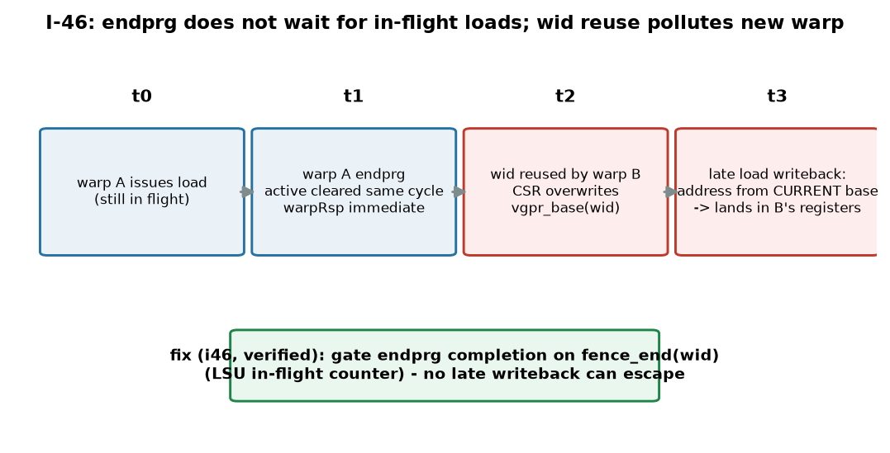

> English translation of the Chinese master `doc/bugs/I-46-endprg不等在飞访存.md`. Translated 2026-09-13.

# I-46 Detailed Defect Analysis Report: endprg Does Not Wait for In-Flight Memory Ops + wid Reuse → Late Writeback Pollutes the New Warp's Registers

| Item | Content |
|---|---|
| ID | I-46 |
| Source location | `ventus/src/pipeline/warp_schedule.scala:47,55,180` (endprg has no memory-op condition, warpRsp immediate, active cleared the same cycle; the ldst/switch drain interface at `:39-40` was deleted by commenting out); `CTA2warp.scala:56,59,63` (a free slot is reused immediately); `CSR.scala:296-301,355` (dispatch overwrites sgpr/vgpr_base); `operandCollector.scala:604,606` (the writeback address is computed on the fly from the **current** base(wid)), `:621-624` (writeback always accepted); `LSU.scala:572-577` (the fence_end in-flight counter exists but only feeds fence, not endprg); `pipe.scala:219` (exe_busy tied to false) |
| Type | Functional bug (silent data pollution) — a cross-module "wid lifecycle" problem family |
| Severity | **High** (the new warp reads the old warp's load data, silently wrong data; the fix is modeled and verified + the patch is ready) |
| Confirmation status | 【Confirmed】, fixed version modeled and verified (guard theorem + fixed-version A2 model + SMMem integration) + the patch passed compile/regression in the 38-patch combined tree |
| Primary evidence | 【Lean machine-checked proof】mechanism facts EIF-1~4 + end-to-end witness (pollution lands) + fix guard theorem (fix-as-verification); 【direct source reading】line-by-line check of the six source-file locations |
| Lean model | `lean/Ventus/Spec/EndprgInflight.lean` (cross-module risk-chain checking machine, 333 lines); fixed version `lean/VentusF/Schedule.lean` (`fschWs_endprg_gated` etc.), integration `lean/VentusF/SMMem.lean` (`fsmmT_i46_endprg_after_drain`) |
| Reproduction/patch | ChiselSim end-to-end reproduction ready to be written (not executed in this environment); patch `i06-i07-i46-warp-schedule-endprg.patch` (internal fix manifest; not released) (merged with I-6/I-7) |
| Related entries | I-25 (same family: bookkeeping consequences of same-cycle wid reuse), I-47 (the expansion and discharge of this entry's file-header "incidental observation": WG completion report does not wait for flush), I-6 (same patch file), I-49 (same-module liveness defect) |

---

## 0. Abstract

When a warp executes endprg (program end), warp_scheduler immediately issues the completion response (warpRsp), CTA2warp releases that wid's slot the same cycle, and on the next cycle a new warp can reuse the same wid and overwrite its vgpr_base/sgpr_base register bases. **The problem is that endprg does not wait at all for the warp's in-flight memory operations (loads already issued, not yet written back)**: the LSU's late writeback carries only wid + register number, and the physical address is computed on the fly at the writeback cycle from the **current** `vgpr_base(wid)` (operandCollector.scala:604) — by then the base has already been overwritten by the new warp, so the old warp's load data lands in the new warp's logical register: silently wrong data.

Ironically, the protective signal already exists in the hardware: the LSU's `fence_end(wid)` (shiftBoard in-flight count drained, LSU.scala:577) is exactly the "this wid has no in-flight memory ops" flag, but it only feeds the fence instruction's wait logic, not endprg; the once-designed ldst/switch drain interface at warp_schedule.scala:39-40 was deleted by commenting out. The fix is to wire fence_end into the endprg completion condition — the patch is ready (i06-i07-i46, warp_control.ready gating), and the fixed-version guard theorem `eif_guarded_endprg_safe` is proven: an endprg released under the guard necessarily satisfies "this wid has no in-flight writeback".

Lean end-to-end witness (native_decide 6-cycle trace): warp A endprgs with an in-flight load (0xDEADBEEF → v8) → the slot is released the same cycle → warp B reuses the slot and the base is overwritten to 128 → the late writeback computes physical address 34 from the new base (B's logical v8), while A's original destination address 2 never receives the writeback — B writes no register at all, yet its v8 silently becomes A's load data.

---

## 1. Module Function and Design Intent

### 1.1 Background Concepts

- **warp lifecycle**: dispatch (warpReq, allocate wid, write vgpr_base etc.) → fetch/issue/execute → endprg (warp_control channel, `simt_stack_op=1`) → completion response warpRsp → slot released, wid reused.
- **In-flight memory ops**: a load has a multi-cycle latency between the LSU accepting the memory request and writing back to the register file (MSHR, DCache miss, L2 round trip — up to hundreds of cycles). During this time the warp's other instructions execute normally, with dependents blocked by the scoreboard.
- **wid reuse**: an SM has only 8 hardware warp slots (num_warp=8); when a warp ends its slot must be reclaimed for a new warp — reuse is routine.
- **Writeback addressing**: a load's writeback request carries only `warp_id + reg_idxw` (WriteVecCtrl/WriteScalarCtrl); the physical bank address = `vgpr_base(wid)>>2 + reg_idxw>>2`, computed **on the fly** at the writeback cycle. The base is not carried in the writeback request — this is the structural root of this bug.

### 1.2 Design Intent

endprg's intended meaning is "all of this warp's work is done". Correctness requires: the slot release (wid may be reused, bases may be overwritten) must not happen before all of the warp's side effects (including in-flight load writebacks) have landed. The hardware's `fence_end(wid)` (the LSU shiftBoard per-warp in-flight count drained flag) is precisely the signal designed for this kind of wait, but it is only wired into the fence instruction path.

---

## 2. Construct-by-Construct Reading of the Original Code

**Construct 1: endprg has no memory-op condition whatsoever** (`warp_schedule.scala:47,55`, ★ hazard one):

```scala
val warp_end=io.warp_control.fire&io.warp_control.bits.ctrl.simt_stack_op
...
io.warpRsp.valid:=warp_end // always ready.
```

`warp_end` only looks at the warp_control handshake and the instruction type; the comment // always ready says in its own words that it waits for nothing. The commented-out interface at `:39-40` records the former design intent in its own words:

```scala
//val ldst = Input(new warp_schedule_ldst_io()) // assume finish l2cache request
//val switch = Input(Bool()) // assume coming from LDST unit (or other unit)
```

"Drain the memory ops" was once part of the design; it was deleted during implementation.

**Construct 2: active and the slot released the same cycle** (`warp_schedule.scala:180`, `CTA2warp.scala:63`):

```scala
warp_active:=(warp_active | (...warpReq.fire...)) & (~(Fill(num_warp,warp_end)&(1.U<<warp_end_id)...)).asUInt
```

```scala
idx_using:=(idx_using | ...CTAreq.fire...) & (~((Fill(num_warp,io.warpRsp.fire)).asUInt & ((1.U<<io.warpRsp.bits.wid))...)).asUInt
```

On the endprg/warpRsp.fire cycle, the active bit and the idx_using bit are cleared synchronously — on the next cycle `PriorityEncoder(~idx_using)` can already give that wid to a new warp (CTA2warp.scala:59).

**Construct 3: dispatch overwrites the bases** (`CSR.scala:296-301,355`):

```scala
when(io.CTA2csr.valid){
  ...
  sgpr_base_dispatch:=io.CTA2csr.bits.CTAdata.dispatch2cu_sgpr_base_dispatch
  vgpr_base_dispatch:=io.CTA2csr.bits.CTAdata.dispatch2cu_vgpr_base_dispatch
  ...
}
...
vCSR(io.CTA2csr.bits.wid).CTA2csr.valid:=io.CTA2csr.valid
```

On the new warp's dispatch cycle, that wid's vgpr_base/sgpr_base are unconditionally overwritten with the new WG's bases.

**Construct 4: the writeback address is computed on the fly from the current base; writeback always accepted** (`operandCollector.scala:604-606, 621-624`, ★ hazard two):

```scala
wbVecBankAddr := (io.vgpr_base(io.writeVecCtrl.bits.warp_id) >> log2Ceil(num_bank).U).asUInt + (io.writeVecCtrl.bits.reg_idxw >> log2Ceil(num_bank).U)
wbScaBankAddr := (io.sgpr_base(io.writeScalarCtrl.bits.warp_id) >> log2Ceil(num_bank).U).asUInt + ...
...
io.writeScalarCtrl.ready := true.B
io.writeVecCtrl.ready := true.B
```

The writeback request carries only wid + reg_idxw; `vgpr_base(wid)` takes the **writeback cycle's** current value. The writeback channel is constantly ready — a late writeback has no chance of being intercepted or dropped.

**Construct 5: fence_end exists but is not wired to endprg** (`LSU.scala:572-577`):

```scala
val shiftBoard=VecInit(Seq.fill(num_warp)(Module(new ShiftBoard(lsu_num_entry_each_warp)).io))
shiftBoard.zipWithIndex.foreach{case(a,b)=> {
  a.left:=io.lsu_req.fire & io.lsu_req.bits.ctrl.wid===b.asUInt
  a.right:=io.lsu_rsp.fire & io.lsu_rsp.bits.tag.warp_id===b.asUInt
  }}
io.fence_end:=VecInit(shiftBoard.map(x=>x.empty)).asUInt
```

The per-warp in-flight counter (accept +1 / response −1) and the drained flag all exist and are brought out on the `fence_end` port; in pipe.scala it only feeds the fence wait logic. In addition, `pipe.scala:219` ties `warp_sche.io.exe_busy` to all false — the endprg side lacks even the weak gating of "execution-level busy".

---

## 3. Defect Analysis



### 3.1 Precise Description of the Defect

The risk chain has four links (each link a machine-checked fact EIF-1~4, see §4):

1. warp w issues a load, entering the LSU's in-flight set;
2. w executes endprg: **inflight is preserved verbatim** (the endprg path touches no memory-op state), active is cleared the same cycle, the slot is released the same cycle (under the premise that the FIFO is not full);
3. on the next cycle the new warp B reuses the same wid, and vgpr_base(wid) is overwritten with B's base;
4. the old load's late writeback computes the physical address from the **new base** and lands in B's logical register — B silently reads A's data.

Two unprotected pollution paths:

- **Same-number overwrite**: when the new warp's allocated range covers the old warp's destination register number, B's register is directly polluted (the witness case);
- **Out-of-range pollution**: when the new warp's allocated range is smaller than the old warp's destination register number (vgpr is variably partitioned, per_wf variable), the writeback runs past B's allocation and lands in a neighboring range — potentially hitting an unrelated third live warp.

**Accidental serialization (partially masking, unreliable)**: the old warp's scoreboard busy bit is not cleared until the writeback completes, so a new warp on the same wid that immediately reads the same logical register gets blocked — this masks part of the same-number overwrite scenarios, but (a) it makes the new warp wait in vain for the dead warp's memory latency (a performance side effect); (b) the out-of-range path and the scenarios where "the new warp does not read that register" are completely unprotected; (c) the busy bit is warp-internal bookkeeping and makes no promise whatsoever about cross-warp semantics after wid reuse.

### 3.2 Root Cause

**The writeback path's addressing information is decoupled from the lifecycle information**: the writeback request carries wid + reg_idxw rather than (base snapshot + reg_idxw), and the physical address is computed on the fly at the writeback cycle — this turns "the base table `vCSR(wid)` still belongs to the original warp at the writeback cycle" into an implicit correctness premise, and slot management (endprg releases immediately) breaks that premise. The commented-out ldst/switch interface at `:39-40` shows the drain requirement was once recognized and was later lost during evolution (same "maintenance drift" family as I-12).

### 3.3 Harm and Tolerability

- **Harm**: silently wrong data. The new warp reads the old warp's load results, or an unrelated warp's registers are polluted out of range. No trap, no assertion in the whole machine.
- **Trigger condition**: a warp executes endprg with an in-flight load (a load immediately before the kernel's end is a common shape — e.g. the epilogue after loading the last tile) + dense CTA dispatch causing same-cycle slot reuse. Really reachable during back-to-back multi-WG execution.
- **Tolerability**: currently intolerable (correctness-level, everyday trigger surface). Rating: **high**.
- **Incidental observation**: the wg completion report to the host does not wait for flushDCache completion — an ordering risk between store global visibility and the completion report, expanded into the independent entry I-47.

---

## 4. Lean Formal Evidence

`lean/Ventus/Spec/EndprgInflight.lean` (a cross-module composite machine: assembled from the faithful submodels of WarpScheduler/CTA2warp/CSR/OperandCollector; 333 lines, zero sorry, clean axiom audit).

**Mechanism facts EIF-1~4 (symbolic, arbitrary state/input)**:

- `eif_endprg_preserves_inflight` (rfl): on the endprg cycle inflight is preserved verbatim — no wait, no flush; the first link of the risk chain;
- `eif_step_endprg_clears_active` (bv_decide bit-level): endprg clears active the same cycle (warp_schedule.scala:180);
- `eif_step_endprg_frees_slot` (premise: the CTArsp FIFO is not full — honestly flagging I-6's other chain): endprg releases the idx_using slot the same cycle (CTA2warp.scala:63);
- `eif_lateWb_uses_current_base` (rfl): the writeback record does not carry the issue-time base; the address is computed on the fly from the current `vbase(wid)` (line-by-line correspondence to operandCollector.scala:604) — the "trigger" link of the risk chain.

**End-to-end witness (native_decide, 6-cycle hand-constructed trace)**:

- `eifW_endprg_with_inflight`: on cycle 3 three things happen in the same cycle — inflight preserved, active=0, idx_using=0;
- `eifW_reuse`: on cycle 4 warp B reuses slot 0 and `vbase(0)` is overwritten to 128;
- `eifW_pollution` (main theorem): `ocWbVecAddr 0#11 8#8 = 2` (A's original destination) vs `ocWbVecAddr 128#11 8#8 = 34` (computed from the new base); after the late writeback, `rf[34] = 0xDEADBEEF` (B's logical v8 is polluted) while `rf[2] = 0` (A's original destination never received the writeback). All fields observable.

**Fix guard (fix-as-verification)**:

- `eif_guarded_endprg_safe` (pure logic, arbitrary state, no decision-procedure axioms): in the guarded machine (endprg is released only when `eifEndprgGuardOK` = this wid has no in-flight writeback), a released endprg satisfies no-in-flight and does not touch inflight;
- `eifW_guard_violated` / `eifW_guarded_blocks` (native_decide): on the guarded machine, the same witness input has endprg blocked (active/idx_using/inflight all preserved), and endprg is released only after the late writeback lands — the pollution trace is unreachable, and the guard introduces no deadlock (completion proceeds normally after draining).

**Fixed-version A2 model and integration** (`lean/VentusF/Schedule.lean`, `lean/VentusF/SMMem.lean`): `fschWs_endprg_gated` (symbolic: when endprg is requested and this wid's in-flight is not drained, ready=0 and it is not accepted), `fschWsT_i46_blocked`/`fschWsT_i46_released` (the witness is first blocked then released on the fixed version), SMMem whole-machine integration `fsmmT_i46_endprg_after_drain` (endprg deferred until the in-flight drain).

---

## 5. Simulation Verification

**ChiselSim end-to-end reproduction**: ready to be written, **not executed in this environment** (status per the doc/03 original text). Test design: a warp executes endprg with an in-flight load + the slot is immediately reused to dispatch a new warp; observe the new warp's registers being polluted by the old load's data. The model-side 6-cycle pollution trace (`eifW_pollution`) can be translated directly into test stimulus.

**Indirect measurement from the patch-tree regression** (doc/22, 2026-09-10): the i06-i07-i46 patch passed regression with WarpSchedulerBugRepro in the 38-patch combined tree — test adaptation empirically confirmed the patch semantics: "not poking fence_end (=0) caused all endprgs to be backpressured (the I-6 premise failed on the first run, I-5/I-7 spun idle and falsely green); after pokeIdle added `fence_end := all-ones`, 4/4 truly green" — i.e. the fixed hardware really does gate endprg on fence_end, and the gating behavior really executes in RTL simulation.

---

## 6. Upstream Impact Analysis

- **Trigger surface**: every "load epilogue + endprg" kernel shape × dense CTA dispatch (wid reuse is routine). endprg is the mandatory path of every warp.
- **Why upstream didn't find it**: (a) the scoreboard busy bit's accidental serialization masks the main "same-number overwrite" shape; (b) in existing test kernels there are usually enough subsequent instructions between the load and endprg (instructions consuming the load result get blocked by busy, incidentally giving the writeback cycles to land); (c) observation requires a cross-warp comparison of "the new warp read old data", which single-warp tests inherently cannot see.
- **Fix compatibility**: fence_end is an existing signal; the fix only adds a gating term and does not change the datapath; for warps with no in-flight memory ops (the vast majority of endprgs) the guard is constantly true, with zero performance loss.

---

## 7. Fix and Fix Verification

**Fix direction** (doc/03 / the internal fix manifest, functional fix required): wire `fence_end(wid)` into the endprg completion condition — an endprg is accepted only when this wid has no in-flight writeback; the slot release must not precede late writebacks.

**Patch** (`i06-i07-i46-warp-schedule-endprg.patch` (internal fix manifest; not released), merged with I-6/I-7 into one file):

- `warp_schedule.scala` gains a new `fence_end` input port (1 bit per warp);
- `warp_control.ready` gains the gating term `!(simt_stack_op & !io.fence_end(io.warp_control.bits.ctrl.wid))` — an endprg with in-flight memory ops is backpressured and accepted only after draining;
- `pipe.scala` wiring: `warp_sche.io.fence_end := lsu.io.fence_end`.
- (The same file's I-6 fix changes warpRsp to a standard Decoupled whose valid holds until ready; the I-7 fix swaps the Req/Rsp block order of belong/endprg_cnt to "clear first, set later".)

**The fix-verification trio**:

- Effectiveness: guard theorem `eif_guarded_endprg_safe` + block/release witnesses `eifW_guarded_blocks` (the original pollution trace is unreachable on the guarded machine, and completion proceeds normally after draining); A2 model `fschWs_endprg_gated`/`fschWsT_i46_blocked`/`fschWsT_i46_released`; SMMem integration `fsmmT_i46_endprg_after_drain`;
- Regression safety: the guard only changes behavior when "endprg with in-flight"; with no in-flight it matches the original semantics; the 38-patch combined tree passed compile/regression (doc/22, including the RTL measurement of 4/4 truly green after the fence_end adaptation);
- Semantic-equivalence note: the patch is implemented as "acceptance gating" (warp_control.ready), while the model guard is "endprg deferred" — the internal fix manifest already notes that the two are semantically equivalent (accept-gating ⟺ warpRsp delayed).

---

## 8. Conclusion

| Evidence layer | Content | Strength |
|---|---|---|
| Direct source reading | warp_schedule.scala:47,55,180 + the :39-40 comment remnants; CTA2warp.scala:56,59,63; CSR.scala:296-301,355; operandCollector.scala:604,606,621-624; LSU.scala:572-577; pipe.scala:219 | Six source-file locations line by line |
| Lean machine-checked proof | EIF-1~4 mechanism facts (rfl/bv_decide, arbitrary state) + `eifW_endprg_with_inflight`/`eifW_reuse`/`eifW_pollution` (native_decide end-to-end witness) | Mechanism universal-level + trace-level |
| Fix verification | `eif_guarded_endprg_safe` (guard safety, pure logic, arbitrary state) + `eifW_guarded_blocks`; A2 model and SMMem integration; patch-tree regression (fence_end gating behavior measured to work) | Machine proof + measurement |
| Simulation reproduction | ChiselSim end-to-end ready to be written (not executed in this environment) | Ready-to-run (not executed in this environment) |

I-46 is the most directly harmful entry in the "lifecycle bookkeeping" defect family (same root as I-25: same-cycle wid reuse): it writes the old warp's data into the new warp's registers, and the ready-made protective signal in the hardware (fence_end) together with the commented-out design remnant (:39-40) jointly show this is protection lost during evolution, not an unknown risk. The fix cost is extremely low (one gating term + one wire), and both the machine proof and the patch regression are closed.
