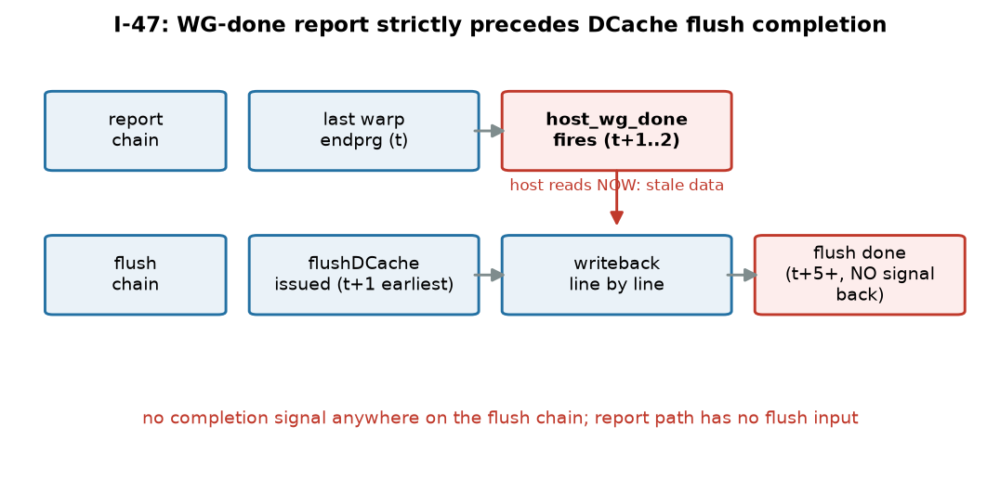

> English translation of the Chinese master `doc/bugs/I-47-上报先于flush完成.md`. Translated 2026-09-13.

# I-47 Detailed Defect Analysis Report: WG Completion Report Strictly Precedes flushDCache Completion (No Flush-Completion Signal)

| Item | Content |
|---|---|
| ID | I-47 |
| Source location | The report chain has no flush input end to end: `warp_schedule.scala:47,55` → `CTA2warp.scala:63,73` → `cta/cu_interface.scala:156,179,221` → host_wg_done; the flush chain is one-way-initiated with no completion return: `warp_schedule.scala:169-172` (bookkeeping of "once issued, it's done"), `DCache.scala:464-503` (the actual flushing, writing dirty lines back to L2 one by one, tracked by no bookkeeping) |
| Type | Functional bug (system-level ordering violation: the completion report precedes data's global visibility) |
| Severity | **High** (the host's standard "read upon completion" flow reads stale data; the report is early by ≥2 cycles + ≥1 cycle per dirty line, tens to hundreds of cycles in practice) |
| Confirmation status | 【Confirmed】, fix guard theorem proven + patch design-verified (compile/elaboration passed; functional regression not run) |
| Primary evidence | 【Lean machine-checked proof】structural independence main theorem (induction over arbitrary-length traces) + end-to-end witness (the report is still 2 cycles early in the most-favorable case) + fix guard theorem; 【direct source reading】end-to-end check of the report chain / flush chain |
| Lean model | `lean/Ventus/Spec/FlushOrdering.lean` (cross-module risk-chain checking machine, 469 lines); fixed version `lean/VentusF/Mem.lean` (`fmem_i47_*`) |
| Reproduction/patch | ChiselSim end-to-end reproduction ready to be written (not executed in this environment); patch `i47-flush-completion-return.patch` (internal fix manifest; not released) (8 files, mill compile + whole-chip elaboration passed; functional simulation regression not run) |
| Related entries | I-46 (this entry began as its "incidental observation", expanded and discharged into an independently confirmed item), I-5/I-6 (when combined, the flush may never happen while the report still fires), I-48 (the patch design is deliberately orthogonal: the completion point does not count coreRsp) |

---

## 0. Abstract

Ventus's WG completion flow has two chains: the **report chain** (last warp endprg → warpRsp → CTA2warp FIFO → cu_interface gather → `host_wg_done` notifying the host) and the **flush chain** (warp_schedule issues the flushDCache request → LSU → DCache writes dirty lines back to L2 one by one and invalidates). This entry confirms: these two chains have **zero coupling in hardware** — the entire report chain has no flush-state input, and the flush chain is one-way-initiated with no "completion" signal returning. The consequence: the WG completion report **strictly precedes** flushDCache completion; when the host follows the standard OpenCL flow of "read the result buffer upon receiving the completion notification", what it reads is stale data that has not yet been written back.

The evidence stands out on two points: (1) the structural main theorem `floRun_report_indep` proves by induction over input sequences of **arbitrary length** that the report chain's evolution is completely independent of the flush state (not dependent on any concrete timing); (2) the end-to-end witness takes the abstraction **most favorable** to the flush side (zero dirty lines, zero L2 latency, host always ready) and still obtains "report fires on cycle 3, flush completes only on cycle 5" — the report is at least 2 cycles early; with dirty lines each line adds ≥1 more cycle (the DCache's single memReq port writes back line by line), and the practical window is tens to hundreds of cycles. A worse combined form: when combined with I-5/I-6, the flush may **never happen** while the report still fires.

Fix direction (patch design-verified): add a completion return to the flush chain (the DCache takes this flush's own L2 hintAck as the completion point → per-CU credit counter → gating cu_interface.scala:221's host_wg_done.valid). The guard semantics is proven in Lean (in the gated machine, a report fire necessarily happens after flush completion), and the fixed-version model witness goes green; the patch spans 8 files, passed mill compile and whole-chip elaboration; the functional simulation regression has not been run (recommended to be done before upstream submission).

---

## 1. Module Function and Design Intent

### 1.1 Background Concepts

- **WG completion semantics**: the host submits a kernel to the GPU, split into several WGs; after all warps of each WG have executed endprg, the hardware should report to the host "this WG is complete". Under the standard OpenCL/GPGPU programming model, upon receiving the completion notification the host assumes **the results are visible in global memory** and immediately reads back the result buffer.
- **The role of flushDCache**: a warp's stores first land in the SM's private L1 DCache (write-back); only a flush/invalidate that writes dirty lines back to L2 makes the data visible to the host (via the shared L2/memory). Therefore a correct implementation of "WG complete" requires: report ⟹ this WG's stores are globally visible, i.e. **flush completion is a prerequisite**.
- **Participants of the two chains**: report chain = warp_schedule (endprg bookkeeping) → CTA2warp (response FIFO) → cu_interface (gather counting, host_wg_done); flush chain = warp_schedule (initiates flushDCache) → LSU (pass-through) → DCache (writes dirty lines back to L2 one by one + invalidate).

### 1.2 Design Intent

The bookkeeping at warp_schedule.scala:169-172 shows the design intent is "once the flush request is issued, consider it handled": `warp_wg_valid(flush_entry)` is cleared on the very cycle the flushDCache handshake succeeds, and thereafter the wg's flush transaction is tracked by nobody in the entire system. This is harmless if the WG has no side effects (pure computation); but when a WG has stores, the link of flush completion is missing between "complete" and "visible".

---

## 2. Construct-by-Construct Reading of the Original Code

**Construct 1: flush bookkeeping is "once issued, it's done"** (`warp_schedule.scala:165-172`):

```scala
warp_endprg_mask_0(i) := (warp_endprg_cnt(i).orR === false.B) && warp_wg_valid(i)
...
val need_flush = warp_endprg_mask_0.asUInt.orR
val flush_entry = OHToUInt(warp_endprg_mask_0.asUInt)
when(warp_endprg_mask_0(flush_entry) && io.flushDCache.ready){
  warp_wg_valid(flush_entry) := false.B            // ★ cleared as soon as the handshake succeeds; nobody tracks this flush thereafter
}
io.flushDCache.valid := need_flush
```

Note that `need_flush` reads the register's old value — the flush is raised at the earliest on the cycle **after** the last endprg (machine proof `floW_flush_starts_after_endprg`), inherently starting one cycle later than the report chain.

**Construct 2: the report chain starts the same cycle** (`warp_schedule.scala:47,55` + `CTA2warp.scala:63,73`):

```scala
val warp_end=io.warp_control.fire&io.warp_control.bits.ctrl.simt_stack_op
io.warpRsp.valid:=warp_end // always ready.
```

```scala
val CTArsp_fifo = Queue(io.warpRsp, 16)   // on the endprg cycle, enters the report FIFO
```

On the very cycle of the last warp's endprg, the response enters the report FIFO — in parallel with, or even earlier than, the flush's initiation (from the next cycle on).

**Construct 3: cu_interface's report logic has no flush input** (`cu_interface.scala:217-223`):

```scala
val host_wg_done_ok = { val reg = RegInit(false.B)
  reg := Mux(fsm === FSM.UPDATE, io.host_wg_done.fire, reg || io.host_wg_done.fire)
  reg
}
io.host_wg_done.valid := (fsm === FSM.UPDATE && wf_gather_finish) || (fsm === FSM.DEALLOC && !host_wg_done_ok)
```

The valid condition is "the gather FSM count is full" — a whole-module grep finds no flush-related signal whatsoever (the hardware-side check conclusion in the "key facts" of the FlushOrdering.lean file header).

**Construct 4: the DCache's actual flushing is tracked by no bookkeeping** (`DCache.scala:464-503`): an invalidate request checks at st1 `!coreReqTagHasDirty_st1 && MshrAccess.io.empty && WshrAccess.io.empty` (:464-466); with dirty lines it issues PutPart writes back to L2 line by line via InvOrFluMemReq (single memReq port, ≥1 cycle per dirty line), and only after all writebacks does it send the L2 Hint and wait for hintAck. **No signal on this entire completion path returns toward the CTA/host direction** — after the DCache's coreRsp for the invalidate returns to the LSU it only clears `is_flush` (LSU.scala:405-411) and does not enter the CTA chain.

---

## 3. Defect Analysis



### 3.1 Precise Description of the Defect

The end-to-end witness timing (the Lean `floW_*` trace, the **most-favorable** abstraction of zero dirty lines, zero L2 latency, host always ready):

- Cycle 1: the last warp endprgs (response enters the FIFO);
- Cycle 2: flushDCache's valid is raised only now (need_flush reads the old value); in the same cycle the report chain is already advancing in cu_interface;
- Cycle 3: **host_wg_done.fire (the report goes out)** — in the same cycle the flush has only just been accepted by the LSU (phase=1; not even a DCache request has been issued);
- Cycle 5: the flush completes only now (the zero-dirty-line lower bound: `flo_flush_two_steps` proves completion within two cycles is impossible).

That is, even in the most-favorable case the report **strictly precedes** flush completion by ≥2 cycles (`floW_report_precedes_flush`); each additional dirty line delays the flush by ≥1 more cycle (`floW_dirty_delays_flush`, the DCache's single port writing back line by line) — the practical kernel window is tens to hundreds of cycles. Moreover, "the report cycle does not vary with the dirty-line count" (`floW_report_any_dirty`, rfl-level: for any value of dcDirty the report trace is verbatim identical) — the window's size is borne entirely by the flush side; the report side is oblivious.

### 3.2 Root Cause

A structural missing wire: the flush chain is **one-way** (initiate → execute, no completion loop), and the report chain is **self-contained** (all bookkeeping on the CTA side, consuming no flush state). The two chains are born adjacently in warp_schedule (both `need_flush` and warpRsp are driven by the endprg bookkeeping) but are never connected. This is not a wrongly written expression; the microarchitecture is missing a signal channel — the fix must add hardware (a completion return chain), making this the only entry among the four confirmed class-I defects whose "patch must add wiring across 4 modules".

### 3.3 Harm and Tolerability

- **Harm**: the host's "read upon completion" of the result buffer (the standard OpenCL flow) reads stale data — a systematic race, not a low-probability corner. Every WG with stores is exposed in the window.
- **Combined worsening**: when combined with I-5 (flush_entry stuck) / I-6 (warpRsp lost so mask_0 is never set), **the flush may never happen while the report still fires** — then it is not a race but a deterministic read of old data.
- **Mitigating factors**: invalidate semantics writes back first and then invalidates (no data is dropped, only the timing is wrong); if the host reads through the shared L2 (rather than a DMA direct read bypassing the cache) the window shrinks; no explicit flush contract documentation at the driver level has been seen upstream.
- **Rating**: **high** (systematically hit under the standard usage flow; and the defect has no simulation observability — most testbenches have extra synchronization/latency before reading results, sliding right past the window).

---

## 4. Lean Formal Evidence

`lean/Ventus/Spec/FlushOrdering.lean` (469 lines, zero sorry): assembled from the faithful submodels of WarpScheduler/CTA2warp/CuInterface per the real wiring (pipe.scala:166-171, GPGPU_top.scala:111-113,175) into a composite state machine; the flush side uses the **most-favorable abstraction** FloFlush (one cycle for acceptance, one cycle into the DCache, phase=2 clears at most 1 dirty line per cycle — no flush-completion signal exists in the hardware; the abstraction is built purely for analysis, and every simplification makes the flush faster, so the conclusion is conservative).

**Structural main theorem (arbitrary-length trace induction; methodologically the weightiest theorem of this module)**:

- `floRun_report_indep`: for an input sequence of arbitrary length, the evolution of the report chain (c2w + cuif) depends only on the initial values of (c2w, cuif), and is **completely independent** of warp_scheduler's flush bookkeeping and of the flush chain's phase/dirty-lines/completion flag — pure induction, no decision procedure;
- corollary `flo_report_chain_no_flush_input`: with the flush-chain state replaced by any value, the report chain's trace is verbatim unchanged.

**Timing and witness (native_decide / rfl)**:

- `floW_flush_starts_after_endprg`: on the endprg cycle flushDCache.valid is still false (need_flush reads the register's old value) — the flush inherently starts one cycle late;
- `floW_report_precedes_flush` (main witness): cycle 3 host_wg_done.fire with flu.done=false/phase=1; cycle 5 flu.done becomes true;
- `flo_flush_two_steps` (Bool exhaustion, **depends on no axioms**): starting from the idle-clean state, completion within two cycles is impossible — a combinational-level anchor for the lower bound; `flo_flush_done_src` characterizes the done set condition;
- `floW_report_any_dirty` (rfl-level): for any value of dcDirty the report cycle is verbatim unchanged;
- `floW_dirty_delays_flush`: with 1 dirty line accepted, cycle 5 is still not complete.

**Fix guard (fix-as-verification)**:

- `flo_guarded_report_safe` (pure logic, arbitrary state, standard axioms only): in the gated machine (`host_wg_done.ready &&= flush_done`), a report fire ⟹ the flush has completed;
- `floWG_blocked_then_safe` (native_decide trace recheck): under the same witness, the report is blocked on cycles 3 and 4, and released after the flush completes on cycle 5 — the protection is effective and the most-favorable case is only 2 cycles late.

**Fixed-version A2 model** (`lean/VentusF/Mem.lean`): `fmem_i47_report_safe` (guard semantics packaged), `fmem_i47_witness_green` (the original witness goes green), `fmem_i47_regress` (when done=1 the gating degenerates and the valid expression is equivalent to the original — regression safety).

**Axiom audit** (`#print axioms` archived at the file tail): `flo_flush_two_steps` zero axioms; `flo_flush_done_src` only [propext]; `floRun_report_indep`/`flo_report_chain_no_flush_input`/`flo_guarded_report_safe` only [propext, Quot.sound]; the witness family carries the native_decide trust axioms (the `Lean.ofReduceBool` family). This file uses no bv_decide.

---

## 5. Simulation Verification

**ChiselSim end-to-end reproduction**: ready to be written, **not executed in this environment** (status per the doc/03 original text). Test design: with a WG having dirty lines, observe the order between host_wg_done and flush completion (hintAck), with a canary comparison of the data the host reads back.

**Engineering verification of the patch** (i47 patch header note, measured 2026-09-10): `patch -p1 --binary --dry-run` / `git apply --check` applies cleanly onto the 35-patch base tree (applied last); mill (cgroup MemoryMax=48G) `ventus[6.4.0].compile` + test compile passed; `runMain top.GPGPU_gen` whole-chip elaboration + firtool passed (exit 0, only pre-existing warnings); the generated GPU.sv netlist was manually checked: the flush_done chain DataCache → SM_wrapper → CTAinterface → cta_scheduler_top → cu_interface and the flush_credit gating are all present. **The functional simulation regression has not been run** (noted in the patch header; recommended to be done before upstream submission; the gating only delays host_wg_done and does not change the datapath).

---

## 6. Upstream Impact Analysis

- **Trigger surface**: every WG with stores × the host's standard read-upon-completion flow. The window is ≥2 cycles (zero dirty lines) up to hundreds of cycles (many dirty lines).
- **Why upstream didn't find it**: (a) testbenches usually have delays like printing/synchronization between the completion check and reading results, sliding past the window; (b) the simulation environment's L2/memory model often makes the "stale read" happen to read already-written-back data (the race is a timing-probability event, and the window is compressed in simulation); (c) the defect has no error surface — reading old data and reading new data are both "legal values", discoverable only by comparing data contents.
- **Contract perspective**: this entry shows that "WG complete" is an **unspecified event** — the hardware implements a "all warps have stopped" report, while software expects a "data is visible" report. The gap between the two semantic layers is exactly the flush-completion link.
- **Relationship to I-46**: I-46 guarantees a warp's load writebacks land no later than the slot release (register-side visibility); this entry is the store-side dual (global-memory visibility). Only together do the two constitute the complete "WG complete = all side effects landed" semantics.

---

## 7. Fix and Fix Verification

**Fix direction**: gate host_wg_done on "this CU's flush has completed". doc/03's original suggestion took the completion point as `invCoreRsp_st1` (DCache.scala:484-486); **the patch implementation corrected that choice** — invCoreRsp_st1 does not check flushstall/waitforL2flush and completes before the L2 Hint round trip, so taking it would reintroduce an early-completion race; the final completion point takes **this flush's own L2 hintAck** (`wgFlushWaitL2Ack && memRspIsFluOrInv`; the Hint is sent only in invalidatenodirty — i.e. after dirty-line writebacks are done and the WSHR is drained — so its ack implies "writeback done + L2 handshake done"). This choice is naturally immune to I-48 (the duplicate-inv-response defect): the completion count does not count coreRsp at all.

**Patch** (`i47-flush-completion-return.patch` (internal fix manifest; not released), 8 files):

- The forward flush path is untouched; the LSU tags the request with an `isKernelFlush` marker bit (one Bool added to each of DCacheCoreReq_np/DCacheCoreReq, passed through by bulk connect) — distinguishing WG-end flushes from invalidates on the AMO/fence paths (the two kinds of hintAck are indistinguishable on the memRsp port; without tagging, a stale hintAck could release the report early);
- the DCache gains a new `io.flush_done` pulse, returned purely combinationally via SM_wrapper → GPGPU_top → CTAinterface → cta_scheduler_top → cu_interface (unregistered);
- cu_interface gains a per-CU 5-bit `flush_credit` counter, gating :221's `host_wg_done.valid`; only the report path is gated, rt_dealloc is not (resource reclamation is unrelated to global visibility, and the DEALLOC state + the host_wg_done_ok register already handle delayed fire);
- credit-pairing argument (patch header): each WG's end issues exactly one flush, each report consumes exactly one credit, and both sides are in order (single CTArsp FIFO gather FSM; single L2 Hint in flight in the DCache), so the k-th flush completion covers the k-th reported WG — credit>0 ⟺ that WG's covering flush has completed. Upper bound: unreported flushes ≤ CTArsp_fifo depth 16 + pipeline slack < 2^5 (the rationale for the 5-bit width).

**Fix verification**:

- Machine proof: guard `flo_guarded_report_safe` + recheck `floWG_blocked_then_safe` (the original witness is blocked then released); A2 model `fmem_i47_report_safe`/`fmem_i47_witness_green`/`fmem_i47_regress` (regression equivalence: when done=1 the gating degenerates);
- Engineering: patch apply/compile/whole-chip elaboration/netlist check all passed (2026-09-10, patch header and doc/22);
- Outstanding: **the functional simulation regression has not been run** (the gating only delays host_wg_done, so the risk is low, but it is recommended to be done before upstream submission); `cta_test.scala` is adapted to poke flush_done := true (preserving the legacy ungated behavior); a dedicated gated-mode test is future work.

---

## 8. Conclusion

| Evidence layer | Content | Strength |
|---|---|---|
| Direct source reading | The report chain (warp_schedule.scala:47,55 → CTA2warp.scala:63,73 → cu_interface.scala:217-223) and the flush chain (warp_schedule.scala:165-172 → DCache.scala:464-503) checked end to end, zero coupling | Line by line |
| Lean machine-checked proof | `floRun_report_indep` (arbitrary-length trace induction, structural independence) + `floW_report_precedes_flush` (report still ≥2 cycles early in the most-favorable case) + `floW_report_any_dirty`/`floW_dirty_delays_flush` (the window grows with dirty lines) | Full inductive proof + native_decide witness |
| Fix verification | `flo_guarded_report_safe` + `floWG_blocked_then_safe`; A2 model `fmem_i47_*`; 8-file patch passed compile/elaboration/netlist check | Machine proof + engineering measurement |
| Simulation reproduction | ChiselSim end-to-end ready to be written (not executed in this environment); patch functional regression not run | Ready-to-run (not executed in this environment) |

I-47 is this project's representative "structural proof": the essence of the defect is **a missing signal channel**; a paper review would need to track the timing of two chains simultaneously to find it, while `floRun_report_indep` pins "zero coupling between the two chains" as a theorem with a single arbitrary-length trace induction — every witness after that merely quantifies the window size. It is also the most expensive entry to fix (a new completion return across 4 modules); the patch's two non-obvious design points (the completion point taken from this flush's own hintAck rather than invCoreRsp_st1; the isKernelFlush tagging) each come with an explicit anti-race argument, and have passed compile and whole-chip elaboration; the functional regression remains to be done.
