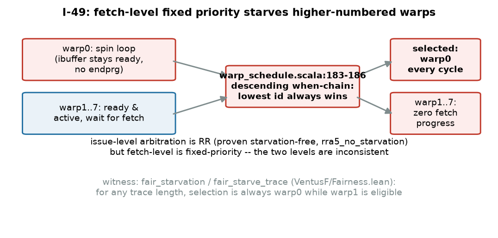

> English translation of the Chinese master `doc/bugs/I-49-取指级固定优先级饿死.md`. Translated 2026-09-13.

# I-49 Detailed Bug Analysis Report: the warp scheduler's fixed-priority selection has policy-level starvation (a liveness defect)

| Item | Content |
|---|---|
| ID | I-49 |
| Source location | `ventus/src/pipeline/warp_schedule.scala:183-186` (the fetch-stage selection policy: a descending `when` chain with last-write-wins ⇒ the lowest-numbered pc_ready warp always wins, ★pitfall); `:184` (the candidacy mask `pc_ready = pc_ibuffer_ready & warp_active` **does not include** the `:181` bar/scoreboard/exe blocking mask); `:49-50,:95` (`current_warp` is only the WireInit fallback value when there is no candidate, **not an RR pointer**) |
| Type | Liveness defect (policy-level) — not a wrong choice on some beat, but "a class of warps may never be chosen" |
| Severity | **Medium-high**: higher-numbered warps make zero progress (no output / hang, not wrong data); when the kernel has cross-warp global-memory dependencies (flag waiting / producer-consumer), it escalates to **whole-machine deadlock**; the impact surface = all higher-numbered warps, and cannot be masked by upper layers |
| Confirmation status | 【Confirmed】 (a mechanism-level machine-checked witness is on record; RTL-level reproduction is ready-to-run (not executed in this environment)) |
| Main evidence | 【Lean machine-checked proof】`fair_starvation`/`fair_starve_trace` (a starvation witness for arbitrarily long traces, proved by induction) + the conditional-fairness family; 【direct source reading】line-by-line check of warp_schedule.scala:183-186 + the fixed-version patches do not touch the selection policy |
| Lean model | `lean/VentusF/Fairness.lean` (325 lines, a wave-R2 deliverable); foundation `lean/Ventus/Schedule/WarpScheduler.lean` (`wsNextWarp`/`ws3_next_warp_min`) |
| Reproduction / patch | No patch (the internal fix manifest: Defense-in-depth / design change; the fix = a policy change, pending discussion with upstream); the Verilator two-warp reproduction design is ready-to-run (not executed in this environment) (doc/03:1088-1089) |
| Related entries | wave-R2 background doc/27 §2 (ruling (c)+(b)); `rra5_no_starvation` (issue-stage RR has no starvation, the control group); the write-back stage's same-family fixed-priority starvation surface (recorded in Ventus/Schedule/Writeback.lean:61-69); I-5/I-6/I-7/I-46 (the same module's bookkeeping family) |

---

## 0. Summary

Every beat, the warp_scheduler must decide "which warp gets to fetch" (pc_req).
The selection logic at warp_schedule.scala:183-186 is a `when` chain scanning
from the highest number down to the lowest; Chisel's "later writes override
earlier writes" semantics makes **the lowest-numbered ready warp always win** —
this is fixed priority, not round-robin (RR).

Consequence: as long as a low-numbered warp enters an unbounded spin (e.g. `j
self`, an infinite loop — the ibuffer stays ready as instructions are issued and
fetched, and with no endprg the active bit stays set), all higher-numbered warps
**never get a fetch opportunity**: fetch stalls ⇒ they never halt. If the kernel
has cross-warp dependencies (one warp waits on a global flag written by another),
and the starved warp happens to be the producer, this escalates to whole-machine
deadlock.

This entry is a **by-product** of wave R2 (2026-09-10, the scheduling-fairness
proof, doc/27): the task was to prove the capping theorem's fairness premise
`capeFairSched`, and the proof was **refuted by a machine-checked
counterexample** — the refutation itself is the witness of this bug
(`fair_starvation`). The positive side was also machine-proved: once a warp
becomes the "minimum candidate" it is selected on that very beat
(`fair_selected_of_min`) — the defect is precisely located at "the beat on which
it becomes the minimum candidate may never come".

This entry also exposes a **two-level policy inconsistency**: the issue stage
(ibuffer→execution units) arbitrates with RR and already has a no-starvation
proof (`rra5_no_starvation`), while the fetch stage uses fixed priority. The
issue stage cannot save the fetch stage — if a warp cannot even fetch
instructions, the fairest issue arbitration has nothing to issue.

---

## 1. Module Function and Design Intent

### 1.1 Background concepts

- **The two-level structure of warp scheduling**: in Ventus, each warp in an SM
  has its own PC. Instruction flow has two stages: (1) the **fetch stage** — the
  warp_scheduler selects a `next_warp`, and via PCcontrol issues a `pc_req` to
  the ICache; the fetched instruction goes into that warp's ibuffer slot; (2) the
  **issue stage** — warps that already have instructions in the ibuffer are
  arbitrated (the rrarbit_x/v at ibuffer.scala:64-65, an RR policy) to the
  execution units. Both stages have a "who goes first" fairness question, but
  their policies may differ.
- **Fixed priority vs round-robin (RR)**: fixed priority = always serve the
  lowest number first; RR = starting from the one served last time, rotate to its
  successor. The former is the simplest to implement (a single when chain), but
  when a low number stays ready, higher numbers **starve**; the latter gives
  every persistent requester bounded waiting (machine-proved by
  `rra5_no_starvation`).
- **Candidacy mask**: `pc_ready(i) = pc_ibuffer_ready(i) & warp_active(i)`
  (:184) — "the ibuffer has room for new instructions" and "the warp is still
  alive". Note it **does not include** the `:181` `warp_ready` blocking mask
  (barrier/scoreboard/execution-unit busy) — a blocked warp still participates in
  fetch candidacy (this is not wasteful: fetch and issue are decoupled, so
  fetching ahead and buffering is fine; but it also means being blocked is not a
  reason to leave the candidacy set).

### 1.2 Design intent

Each beat, send the `pc_req` to one active warp so that every warp's ibuffer
stays fed. `current_warp` (:49-50,:95) looks like a "scheduling pointer", but it
is only the WireInit fallback of `next_warp` — **the holdover value when there
is no candidate**, with no "start from the next one next time" advancing logic.
That is: there is no RR pointer in the code; fixed priority is the only policy.

---

## 2. Line-by-Line Reading of the Original Code

**Construct one: the selection policy itself** (`warp_schedule.scala:183-186`,
★pitfall):

```scala
for (i<- num_warp-1 to 0 by -1){
  pc_ready(i):= io.pc_ibuffer_ready(i) & warp_active(i)   // :184 candidacy mask
  when(pc_ready(i)){next_warp:=i.asUInt}                  // :185 descending when chain
}                                                          // ★ last write wins ⇒ the lowest number always wins
```

The loop scans from num_warp-1 (=7) down to 0, and every ready i executes
`next_warp := i` once. Under Chisel semantics, multiple `:=` writes to the same
Wire on the same beat **let the later write override the earlier one**, so the
write that ultimately takes effect is the last one in the loop — i.e. the
**lowest-numbered ready warp**. `io.pc_req.valid := pc_ready(next_warp)` (:187),
`io.pc_req.bits.warpid := next_warp` (:99).

**Construct two: current_warp is not an RR pointer** (:49-50,:95):

```scala
val current_warp=RegInit(0.U(depth_warp.W))   // :49
val next_warp=WireInit(current_warp)          // :50 fallback holdover when there is no candidate
...
current_warp:=next_warp                       // :95
```

`current_warp` only catches next_warp via WireInit "when there is no candidate
at all"; it is overwritten by next_warp every beat and has no biasing influence
on the selection result (already proved by `ws3_next_warp_min`: when there is a
candidate, the result is independent of cur). Mistaking it for an RR pointer is
the easiest error to make when reading this code — both doc/03 and the
Fairness.lean header note specifically flag this point.

**Construct three (control): the issue stage is RR**. The `rrarbit_x/v` at
ibuffer.scala:64-65 instantiates Chisel's RRArbiter, whose "persistent
requesters get bounded waiting" has been machine-proved by
**`rra5_no_starvation`** in `lean/Ventus/Schedule/RRArbiter.lean`. The two-level
policy inconsistency is thus established: the issue stage is fair, the fetch
stage is not.

**Fixed-version patch audit** 【direct source reading】: the fix patches for
I-5/I-6/I-7/I-46 (i05, i06-i07-i46) do not touch the selection policy at
:183-186; the fixed-version model `VentusF/Schedule.lean:775`'s `fschWsStep`
reuses `wsNextWarp` unchanged (verified against the Fairness.lean header note) —
the starvation surface exists unchanged in the fixed version.

---

## 3. Bug Analysis



### 3.1 Precise description of the defect

**Policy-level starvation**: there exists a legal execution scenario in which
some active warp is not selected by pc_req even once within a time window of
**arbitrary length**.

Concrete construction (i.e. the machine semantics of the Lean witness): warp0 is
dispatched into wg0, warp1 into wg1; warp0 runs an unbounded spin (e.g. `j self`:
a branch to itself — the ibuffer stays ready as instructions are issued and
fetched; with no endprg, active stays 1). Then on every beat pc_ready = 0b11, and
construct one's when chain always writes next_warp := 0. **warp1's fetch never
happens** ⇒ warp1's instructions never execute ⇒ it never halts (a liveness
failure for warp1; if it holds a resource/flag other warps are waiting for, the
failure propagates into a whole-machine deadlock).

Precise boundary (nailed by the conditional-fairness theorem family): if warp w
becomes the **minimum candidate** on some beat (itself a candidate and all
lower-numbered warps not candidates) ⇒ it is selected on that beat
(`fair_selected_of_min`). That is, starvation holds if and only if "there exists
a lower-numbered warp that is persistently a candidate" — the defect's necessary
and sufficient condition is machine-checked.

### 3.2 Root cause

A design choice: the fetch stage uses fixed priority because it is the simplest
to implement (a single descending when chain, stateless), and the designer left
the comments `//lock one warp to execute` / `//next_warp:=0.U` (:188-189),
indicating a coarser policy was once considered. No mechanism (aging, rotation,
quota) prevents a low number from dominating long-term. The root cause is not a
coding error but **the absence of fairness at the policy level** — exactly why
this entry is a by-product of a "prove fairness" task: the fairness is not
unproved, it is false.

### 3.3 Harm and tolerability

- **Harm**: higher-numbered warps make zero progress (no output / hang, not wrong
  data — no result is polluted); the impact surface = all higher-numbered warps;
  it cannot be masked by upper layers (the issue-stage RR cannot save a stalled
  fetch stage, §0 two-level inconsistency).
- **Trigger condition**: a low-numbered warp spins unboundedly and its
  instructions can keep issuing (the ibuffer never fills). The existing
  configuration (num_warp=8) can already trigger it — no special timing is
  needed, only a software shape.
- **Tolerability** (transcribed from doc/03:1085-1087): software discipline (no
  unbounded spins, yielding/sleeping inside spin loops) can avoid it; but this is
  the same structural weakness as I-34/I-45, "safety outsourced to discipline".
  Suggested hardware fix = change the selector to RR or age-based priority
  promotion (§7).

---

## 4. Lean Formal Evidence

All in `lean/VentusF/Fairness.lean` (a wave-R2 deliverable, zero sorry; the axiom
audit at the file end: `fair_starvation` depends only on the three standard
axioms, no trust axioms), built on `wsNextWarp` (the line-by-line translation of
:183-186) and `ws3_next_warp_min` ("the minimum candidate wins", bv_decide) from
`Ventus/Schedule/WarpScheduler.lean`.

**(c) A machine-checked counterexample to unconditional fairness**:

```lean
/-- Starvation witness input: warp0/1's ibuffers are always ready
    (pcIbufRdy=0b11), with no control events. Environmental semantics:
    warp0 is running a spin loop that can issue indefinitely. -/
def fairStarveIn : FschWsIn := ⟨{ wsInNop with pcIbufRdy := 0b11#8 }, 0xFF#8⟩

theorem fair_starvation (n : Nat) :
    ((fschWsRun fairStarveInit (List.replicate n fairStarveIn)).base.warpActive >>> 1)
      &&& 1#8 = 1#8 ∧          -- after any n beats, warp1 is still active (not halted)
    (fairStarveIn.base.pcIbufRdy >>> 1) &&& 1#8 = 1#8 ∧   -- warp1 is always a candidate
    fairTrace fairStarveInit (List.replicate n fairStarveIn) = List.replicate n 0#3
      -- yet the entire selection trace is always warp0
```

【Lean machine-checked proof】`fair_starvation`: for **any** trace length n (by
induction on n), warp1 is always active and always a candidate, while the
selection trace is always warp0. Companions: `fair_starve_trace` (the selection
trace is constantly 0), `fair_starve_active` (the active=0b11 invariant),
numerical instances T1/T3 (native_decide).

**(b) Conditional fairness (the positive side, which also nails the defect's
necessary-and-sufficient boundary)**:

- `fair_selected_of_min`: if w is a candidate and all lower numbers are not ⇒ w
  is selected on that very beat;
- `fair_mem_trace`: if w becomes the minimum candidate at some beat of a trace ⇒
  w enters the selection trace (trace-level liveness);
- `fair_run_stable_min`: if w is constantly the minimum candidate ⇒ w is selected
  every beat;
- `fair_warp0_wins`: once warp0 becomes a candidate it is selected immediately
  (no lower number exists, unconditional).

**The conditional version of contract discharge**: `fair_capeFairSched` — the
capping theorem's scheduling-fairness contract `capeFairSched` is **demoted to a
hypothesis-carrying theorem**: the hypothesis hcov = "every un-halted warp
becomes the minimum candidate at some beat of the trace" (to be supplied by the
execution semantics: low-numbered warps eventually endprg / have no permanent
spins). `fair_starvation` shows this hypothesis **cannot be obtained for free**
under a fixed-priority policy — exactly the formal landing point of doc/27's R2
ruling "(c)+(b)", and also the residual registered under doc/21 G-E4.

**Control theorem**: `rra5_no_starvation` (Ventus/Schedule/RRArbiter.lean) — the
issue-stage RR arbitration's "persistent requesters are eventually granted" is
proved. The two theorems side by side constitute the machine evidence for the
"two-level policy inconsistency".

---

## 5. Simulation Verification

**Ready-to-run (not executed in this environment)** (transcribed from
doc/03:1088-1089):

- Reproduction design (Verilator whole-machine level): a two-warp experiment —
  warp0's program is `j self` (spin), warp1's is any program; observe that
  `io.pc_req.bits.warpid` is constantly 0 and warp1's ibuffer never receives new
  instructions. Expected result: warp1 makes zero progress (no finished, no
  memory writes).
- doc/22-复现执行结果.md has no record of this entry (the 31 cases covered by the
  reproduction wave 09-06~09-10 do not include I-49 — the bug was only discovered
  in wave R2 on 09-10, after the reproduction package was finalized).
- Note on mechanism-level determinism: this entry's trigger does not depend on
  timing coincidence (unlike the same-beat event families of I-5/I-7), only on
  the software shape (a low-numbered spin), so the RTL reproduction is expected
  to succeed stably; given that the formal evidence already provides an inductive
  proof for arbitrarily long traces, the value of simulation reproduction is
  mainly end-to-end corroboration.

---

## 6. Upstream Impact Analysis

- **Trigger surface**: any kernel with warp count ≥ 2 where a low-numbered warp
  can spin unboundedly. The current configuration num_warp=8 is included.
  Spin-waiting (spin-locks, producer-consumer flags) is a common pattern in GPU
  programming — this entry's trigger condition is not rare in real kernels.
- **Why upstream did not find it**: the official test kernels' warps all
  terminate in bounded time and do no cross-warp spin-waiting; moreover,
  starvation produces no wrong data and only manifests as a hang under specific
  kernel shapes, which is hard to attribute to the scheduling policy.
- **Impact on the capping theorem** (doc/27 R2, doc/26:181): the unconditional
  form of `capeFairSched` is refuted by this entry and has been demoted to
  `fair_capeFairSched` with an explicit hcov hypothesis; doc/21 G-E4 registers
  this as a residual gap (the hypothesis cannot be unconditionally discharged;
  `fair_starvation` is exactly a machine-level counterexample to
  `ctlWfDoneLive`).
- **Collateral ruling**: the write-back stage has a same-family fixed-priority
  starvation surface (fetch_ctl suppressed by the alu branch), already recorded
  in Ventus/Schedule/Writeback.lean:61-69 (the doc/03 review-note family).

---

## 7. Fix Proposal and Fix Verification

**No patch** (the internal fix manifest classification "Defense-in-depth / design change": the
fix = a policy change, requiring discussion with upstream; no local patch is
made). Fix directions (transcribed from doc/03:1086-1087 + expanded):

1. **Make the selector RR**: replace the descending when chain at :183-186 with
   round-robin — use `current_warp` (:49, a ready-made register) as the RR
   pointer, each beat scanning circularly from its successor for the first
   pc_ready warp; or reuse the RRArbiter scheme (ready-made in Chisel, and
   `rra5_no_starvation` already vouches for its fairness). Note that RRArbiter
   with count=1 is not Irrevocable (on record in the doc/03 notes), but the
   pc_req channel has no cross-beat hold requirement, so this is not an obstacle.
2. **Age-based priority promotion**: the longer a warp waits, the higher its
   priority (more expensive to implement than option 1, with stronger fairness).
3. **Software-side mitigation (when hardware is not fixed)**: programming
   discipline — no unbounded spins in low-numbered warps, yielding inside spins;
   this is contract documentation, handled in the same family as I-34/I-45.

**Fix verification**: no fixed-version modeling yet. If option 1 is adopted, the
verification path is ready: build an RR variant of `wsNextWarp` → re-prove that
`fair_starvation`'s counterexample no longer holds under the new policy (one
should be able to prove "every persistent candidate has bounded waiting", i.e. a
fetch-stage version of `rra5_no_starvation`) → `fair_capeFairSched`'s hcov
hypothesis can be attempted for discharge as a theorem. Regression safety
requires re-running the existing theorem family of VentusF/Schedule.lean (the
`fschWs*` series is built on the selection policy).

---

## 8. Conclusion

| Evidence layer | Content | Strength |
|---|---|---|
| Direct source reading | warp_schedule.scala:183-186 (descending when chain, last write wins), :184 (candidacy mask excludes the blocking bits), :49-50,:95 (current_warp is not an RR pointer); the fixed-version patches do not touch the selection policy | line-by-line check + patch audit |
| Lean machine-checked proof | `fair_starvation`/`fair_starve_trace` (starvation witness for arbitrarily long traces, by induction); conditional family `fair_selected_of_min`/`fair_mem_trace`/`fair_run_stable_min`/`fair_warp0_wins`; contract discharge `fair_capeFairSched` (hcov hypothesis); foundation `ws3_next_warp_min`; control `rra5_no_starvation` | arbitrary trace length (full inductive proof) |
| Simulation | the Verilator two-warp reproduction design is ready-to-run (not executed in this environment) (doc/03; doc/22 has no record of this entry) | ready-to-run |
| Fix | no patch (policy change, pending upstream decision); fix directions: RR-ization / age-based | proposal level |

I-49 is the project's **only proved liveness defect**, and a model case of a
"prove fairness" task forcing a defect out of the assumption layer: the
unconditional discharge of the fairness contract capeFairSched was refuted by a
machine-checked counterexample, and the refutation itself is the bug's witness.
The two-level policy inconsistency (issue-stage RR proved starvation-free vs
fetch-stage fixed priority) means the issue stage's fairness results are entirely
ineffective against a fetch-stage stall — liveness problems must be solved at the
right level.
