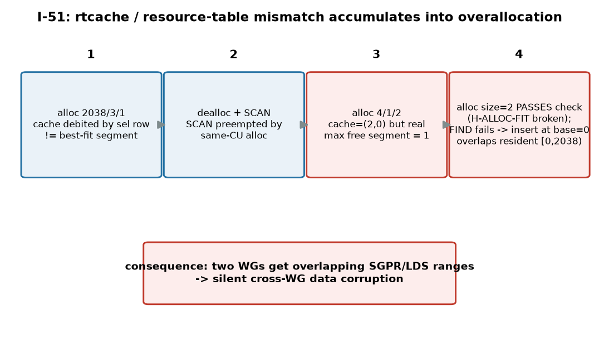

> English translation of the Chinese master `doc/bugs/I-51-rtcache高估腐蚀链表.md`. Translated 2026-09-13.

# I-51 Detailed Defect Report: The allocator's rtcache and rt linked list mismatches accumulate into a resource overestimate; H-ALLOC-FIT fails and WG resource intervals overlap

| Item | Content |
|---|---|
| ID | I-51 |
| Source location | `ventus/src/cta/allocator.scala:86-92` (rtcache_writer decrements by the selected row sel) and `:251-262` (resource check only looks at the orR of the two rtcache rows); `ventus/src/cta/resource_table.scala:560-567` (SCAN/OUTPUT can be preempted by an alloc on the same CU) and `:305-311` (best-fit minimum-fit selection of FIND) |
| Type | Functional bug (silent data corruption direction) — cross-module timing mismatch; a "timing-condition" latent defect |
| Severity | **High** (once hit, two WGs are allocated overlapping SGPR/LDS intervals and overwrite each other's registers/shared memory); but triggering requires all three broken-window conditions to hold simultaneously |
| Confirmation status | 【Confirmed·timing-condition】— fully machine-checked at the event-model level with decide; RTL-level timing reproduction is ready-to-run (not executed in this environment) |
| Main evidence | [Lean machine-checked proof] Complete failure trace (8 events) for the sgpr channel at real parameters N=2048; broken-window witnesses rtcc_w_* all `by decide`; [direct source reading] five locations in allocator/resource_table verified line by line |
| Lean model | `lean/Ventus/CTA/RtCacheConsistency.lean` (544 lines; the discharge/adjudication file for the G2 contract gap; built on the linked-list model in `lean/Ventus/CTA/ResourceTable.lean`) |
| Reproduction/patch | RTL reproduction ready-to-run (doc/22 has no execution record); no patch (fix = monitoring assertion suggestion + root-cause design suggestion) |
| Related entries | ResourceTable Q4 (linked-list corruption when FIND fails without H-ALLOC-FIT; I-51 gives its real-parameter reachable witness); I-25 (same CTA subsystem); the H-ALLOC-FIT/H-ALLOC-SLOT contracts (`Ventus/Spec/Contracts.lean`, doc/27); doc/30 §R4-G2 |

---

## 0. Summary

The CTA scheduler allocates three kinds of physical resources (sgpr/vgpr/lds) as base-address intervals for each WG. To speed up decisions, the allocator maintains a two-row cache rtcache per CU per resource class (holding the lengths of the largest two free segments, **without storing segment numbers**); the actual allocation is done by the linked-list best-fit in resource_table (rt). This defect is a **timing mismatch between the cache and the source of truth**:

- On each alloc, the allocator decrements rtcache by the "checked selected row number sel" (allocator.scala:86-92);
- while rt actually selects the segment by best-fit (resource_table.scala:305-311) — the two selections may differ (the cache does not store segment numbers, so mismatch is unavoidable);
- after each alloc/dealloc, rt rescans (SCAN) and writes back to rtcache to refresh the mismatch; but SCAN can be **preempted** by the next alloc on the same CU (explicitly allowed by the FSM transition table at resource_table.scala:558-567); after preemption the mismatch is not refreshed and can **accumulate** into an overestimate.

This project had listed "timing consistency between rtcache and rt" as an open contract gap G2 (the "cache↔rt" half of H-ALLOC-FIT). The adjudication of the 2026-09-10 wave R4 is: **consistency is not merely unproven — it does not hold at all**. `Ventus/CTA/RtCacheConsistency.lean` gives an 8-event failure trace for the sgpr channel at real parameters (N=2048): after alloc(2038) → alloc(3) → alloc(1) → dealloc → SCAN → alloc(4) → alloc(1) → alloc(2), rtcache=(2,0) while the actual largest free segment is only 1; at that point an alloc with size=2 passes the check on the strength of the overestimated cache (H-ALLOC-FIT fails), rt's FIND finds no segment and inserts a node at the initial value base=0, overlapping the resident WG's interval [0,2038) — two WGs stomp on the same physical registers, silent data corruption.

Positive results are fully proven in the same file: the cache never overestimates the "total remaining" (the total-conservation invariant `rtccInv_run`); distortion is confined to the top-2 structure; the first alloc after a SCAN lands is always safe (`rtcc_fit_after_scan`).

---

## 1. Module function and design intent

### 1.1 Background concepts

- **WG resource allocation**: a workgroup (WG) issued by the host needs three physical resource intervals: scalar registers (sgpr, 2048 slots globally), vector registers (vgpr, 1024), and local shared memory (lds, 128KB). resource_table (rt) records each CU's allocated intervals in an address-ascending **linked list** (node = (addr1, addr2, slot), at most 8 WG slots); allocation is "find a free segment that fits and insert it into the list" (FIND→WRITE); reclamation removes the node (DEALLOC).
- **rtcache**: rt's FIND traverses the linked list (SyncReadMem, several cycles per segment) — too slow to sit inside the allocator's per-CU check loop. Therefore the allocator caches, per CU per resource class, the **lengths of the largest two free segments** (NUM_RT_RESULT=2, two rows), refreshed by rt after each alloc/dealloc: rt SCANs the list, computes the top-2, and writes back via `rtcache_update`. The allocator's RESOURCE_CHECK only looks at the cache: `size ≤ row0 ∨ size ≤ row1`.
- **H-ALLOC-FIT**: the allocation-feasibility contract in the contract registry — "allocator check passes ⇒ rt indeed has a free segment that fits". It has two layers: the decision layer (demand ≤ the cache row selected; Allocator.lean's `alc_h_alloc_fit` is proven) and the timing-consistency layer (cache content ⟺ rt ground truth, i.e. the G2 gap). I-51 adjudicates exactly the latter.
- **Preemption**: the rt handler is a per-CU FSM (ALLOC/DEALLOC/SCAN/OUTPUT); `io.alloc.ready` stays high in the SCAN/OUTPUT states for alloc requests on the **same CU** (resource_table.scala:136-139) — i.e. a new alloc can interrupt an in-flight SCAN/OUTPUT; the SCAN result is discarded and rtcache is not refreshed.

### 1.2 Design intent

The cache is clearly intended to be "always conservative": the decrement happens on the allocator side (immediately), the refresh happens on the rt side (write-back after SCAN). If both sides always referred to the same segment, the cache would be a conservative lower bound of the accurate top-2. The root of the mismatch is that cache rows store only lengths, not segment numbers, and the allocator's row-selection rule (higher row first) and rt's segment-selection rule (best-fit minimum fit) are **not the same selector**.

---

## 2. Construct-by-construct reading of the original code

**Construct 1: the allocator check only looks at the two rtcache rows** (`allocator.scala:251-262`):

```scala
for(j <- 0 until NUM_RT_RESULT) { // higher rt cache line has higher priority
  result_line_sgpr(j) := rtcache_sgpr(cuid).size(j) >= wg.num_sgpr   // :252
  ...
}
// Priority Encoder, MSB has the highest priority
resource_check_result_rtcache_sel_sgpr(i) :=
  PriorityMux(result_line_sgpr.reverse, (NUM_RT_RESULT-1 to 0 by -1).map(_.asUInt))  // :258
resource_check_result(i) := result_line_lds.asUInt.orR && result_line_sgpr.asUInt.orR && ...  // :261
```

That is: the check passes if either row fits; sel = the highest row number satisfying the condition (row 1 has priority).

**Construct 2: on the alloc cycle, decrement by the sel row (★ hazard 1: the decrement target is a "row number", not a "segment")**
(`allocator.scala:86-92`, inside rtcache_writer):

```scala
when(alloc_wr) {
  io.rtcache_wr_cuid := io.alloc_cuid
  for(i <- 0 until NUM_RT_RESULT) {
    io.rtcache_wr_data.size(i) := io.alloc_rawdata.size(i) - Mux(i.U === io.alloc_sel, io.alloc_size, 0.U)
    assert(io.alloc_rawdata.size(io.alloc_sel) >= io.alloc_size)   // :91 only guards against decrement wraparound
  }
}
```

The two cache rows are just two length numbers; the decrement subtracts size from the sel row. The assertion at `:91` guarantees the decremented row is no smaller than size (guards against wraparound), but does **not** guard against "the segment corresponding to the decremented row is not the segment rt actually selected".

**Construct 3: rt's FIND selects the segment by best-fit (★ hazard 2: a different selector from construct 2)**
(`resource_table.scala:305-311`, FIND pipeline stage 3):

```scala
val result_update = (size >= wgsize) && (size < fsm_a_found_size)   // :305 minimum fit
fsm_a_found_size := Mux(fsm_a_valid_p1 && result_update, size, fsm_a_found_size)
fsm_a_found_addr := Mux(fsm_a_valid_p1 && result_update, addr1 + 1.U, fsm_a_found_addr)
```

rt picks the "smallest segment that fits" (best-fit); the allocator decrements the "highest row number satisfying the condition". Example: cache=(6,3) (row0 = 6-segment, row1 = 3-segment), alloc with size=4: sel=0 (row 1 cannot hold 4, so decrement row 0 → (2,3)); rt's best-fit happens to also pick the 6-segment — no mismatch. But with size=1: sel=1 (decrement row 1 → (2,2)), while rt's best-fit picks the smallest ≥1 segment at the time (which may be the 2-segment) — **mismatch occurs; row 1 is inflated**.

**Construct 4: the SCAN refresh can be preempted by an alloc on the same CU (★ hazard 3: the mismatch-refresh mechanism fails)**
(`resource_table.scala:136-139` and `:558-569`):

```scala
io.alloc.ready := (fsm === FSM.IDLE) || (cu_sel === io.alloc.bits.cu_id_local && (
  (fsm === FSM.ALLOC && alloc_ok) || (fsm === FSM.DEALLOC && dealloc_ok) ||
  (fsm === FSM.SCAN) || (fsm === FSM.OUTPUT)          // :138 still accepts same-CU alloc during SCAN/OUTPUT
))
...
is(FSM.SCAN) {
  fsm_next := MuxCase(fsm, Seq(
    io.alloc.fire -> FSM.ALLOC,                       // :560 SCAN preempted by alloc; result discarded
    io.dealloc.fire -> FSM.DEALLOC,
    scan_ok -> FSM.OUTPUT
  ))
}
is(FSM.OUTPUT) {
  fsm_next := MuxCase(fsm, Seq(
    io.alloc.fire -> FSM.ALLOC,                       // :567 OUTPUT can likewise be preempted
    output_ok -> FSM.IDLE,
  ))
}
```

SCAN→OUTPUT is the only refresh path for rtcache (`:522-525` rtcache_update write-back). Preemption leaves that alloc's mismatch **unrefreshed**; if another alloc on the same CU arrives within the window, the check still reads the stale cache — mismatches can accumulate round by round.

**Construct 5: when FIND fails, insert the node at the initial value (★ hazard 4: where the overestimate finally lands)**
(`resource_table.scala:269-270` + `:364-369`):

```scala
fsm_a_found_size := NUM_RESOURCE.U  // :269 initial assumption: the whole table
fsm_a_found_addr := 0.U             // :270 ★ stays at initial value 0 if FIND never updates it
...
rtram_alloc.addr1.wr.data := fsm_a_found_addr              // :366 insert
rtram_alloc.addr2.wr.data := fsm_a_found_addr + wgsize - 1.U  // :369
```

When FIND finds no segment ≥ size (`result_update` stays false throughout), `fsm_a_found_addr` keeps the initial value 0 — WRITE inserts the new node at base=0 as usual, overlapping a resident node's interval (this is the linked-list corruption mechanism already recorded as ResourceTable Q4; I-51 supplies its real-parameter reachable path).

---

## 3. Defect analysis



### 3.1 Precise description of the defect

**The three broken-window conditions** (must hold simultaneously; proven reachable at the event-model level):

- (a) For some alloc, rt's best-fit free segment ≠ the free segment corresponding to the row the allocator decrements (the cache records only top-2 lengths, not segment numbers, so mismatch is unavoidable);
- (b) The SCAN after that alloc does not complete before the next same-CU alloc's resource check (preemption window, resource_table.scala:560-567);
- (c) Within the window, another same-CU alloc passes the check on the mismatched cache.

**Machine-checked failure trace** (sgpr channel N=2048, `rtccTrace` at `RtCacheConsistency.lean:460-470`):

| # | Event | Linked-list effect | cache (c0,c1) |
|---|---|---|---|
| 1 | alloc slot6 size=2038 | F [0,2038), leaving a 10-unit hole | (10,0) |
| 2 | alloc slot0 size=3 | A [2038,2041) | (7,0) |
| 3 | alloc slot1 size=1 | B [2041,2042) | (6,0) |
| 4 | dealloc slot0 | holes merge into 3 and 6 | (6,0) (unchanged) |
| 5 | SCAN lands | — | refreshed to the accurate **(6,3)** |
| 6 | alloc slot2 size=4 | sel=0, decrement row0 → (2,3); rt best-fit 6-segment → C [2042,2046) | (2,3) |
| 7 | alloc slot3 size=1 | sel=1, decrement row1 → (2,2); rt best-fit is the 2-segment (≠ the 3-segment corresponding to row 1) → D [2046,2047): **mismatch; row 1 inflated** | (2,2) |
| 8 | alloc slot4 size=2 | sel=1, decrement row1 → (2,0); rt best-fit 3-segment → E [2038,2040) | **(2,0)** |

At this point the actual free segments are (0,1,0,0,1), and the largest free segment = 1 < the 2 claimed by the cache. The SCANs after allocs 6–8 are each preempted by the next same-CU alloc (condition b), so the mismatch accumulates round by round.

**Failure chain** (H-ALLOC-FIT fails → linked-list corruption → interval overlap):

1. The 9th alloc (size=2): the allocator check `2 ≤ c0` passes (fourth conjunct of `rtcc_w_checks`);
2. but no free segment ≥2 exists in the list (`rtcc_w_nofit`) — H-ALLOC-FIT's "check passes ⇒ a fitting segment exists" is broken;
3. rt's FIND finds no segment (`rtcc_w_find_fails`: upd=false) and inserts at the initial value base=0;
4. the new node slot5's interval [0,1] overlaps the resident filler node slot6's [0,2037] (`rtcc_w_corrupt`/`rtcc_w_overlap`: the two nodes' intervals both contain address 0).

### 3.2 Root cause

**Insufficient information in the cache design + a refresh path that can be preempted**, combined:

- the cache stores only top-2 **lengths**, no segment numbers ⇒ the allocator's decrement cannot align with rt's actual segment selection (selector misalignment between construct 2 and construct 3);
- SCAN is the only refresh, and preemption is **by design** (the comment at :136-139's ready condition explicitly says "able to preempt") — the designer only considered preemption's effect on the atomicity of rt linked-list operations (the alloc re-enters SCAN after completion), and overlooked the side effect that "the preempted alloc has already modified the cache";
- the assertion at `:91` only guards against decrement wraparound (underflow), not against overestimate — there is no defense at all in the overestimate direction.

### 3.3 Harm and tolerability

- **Harm**: two WGs allocated overlapping SGPR (or LDS) intervals → mutual overwriting of registers/shared memory → cross-WG silent data corruption. sgpr overlap compounds the same-type consequence chain of I-11 (register crosstalk); lds overlap means shared-memory stomping.
- **Trigger surface**: requires the combination of "large filler + allocation/reclamation inside small holes + SCAN preemption window" — all three broken-window conditions must hold simultaneously, so it is timing-conditioned; upstream simulation/FPGA has never reported it.
- **Tolerability**: once hit, it is resource-overlap-level data corruption, rated **high**; but low probability. Handle as "latent defect + monitoring assertion" (conclusion copied verbatim from doc/03): first add an assertion to turn latent corruption into an immediate simulation error, then evaluate a root fix.

---

## 4. Lean formal evidence

Everything is in `lean/Ventus/CTA/RtCacheConsistency.lean` (event model: state = (rt linked list, two rtcache rows); events = scan/alloc/dealloc; line-by-line correspondence to allocator.scala:86-92/:251-262 and resource_table.scala's SCAN/FIND/WRITE). **Axiom audit: all theorems depend only on the standard axioms and decide; no bv_decide/native_decide trust axioms** (the file's §5 `#print axioms` block is on record).

**Broken-window witnesses (N2, sgpr channel at real parameters N=2048, all `by decide`)**:

- `rtcc_w_scan_cache`: after the SCAN lands, cache=(6,3), consistent with the top-2 of the then-current free segments (0,3,6) (the refresh mechanism itself is correct);
- `rtcc_w_final_cache`: after 8 events, cache=(2,0);
- `rtcc_w_gapmax`: the actual largest free segment = 1 — "each cache row ≤ largest free segment" is breached (direct evidence for N1);
- `rtcc_w_checks`: the allocator check passes for every alloc within the window (including the broken-window fourth one, size=2);
- `rtcc_w_nofit`: **H-ALLOC-FIT fails** — check passes ∧ no free segment ≥2 exists in the list;
- `rtcc_w_find_fails`: rt's FIND finds no segment (upd=false);
- `rtcc_w_corrupt`: the size=2 alloc is inserted into slot5 at FIND's initial value base=0, interval [0,1];
- `rtcc_w_overlap`: slot5 [0,1] and resident slot6 [0,2037] both contain address 0 (formalization of the overlap predicate).
- Auxiliary: `rtcc_w_fit5/6/7` prove that each of the first three in-window allocs had a genuinely fitting free segment on its own cycle — the mismatch accumulates "safely", step by step, not in one jump.

**Positive results (P1/P2/P3, fully proven in the same file)**:

- **P1 `rtcc_sound_step`**: if both cache rows are no larger than the current largest free segment, then check passes ⟹ rt indeed has a fitting free segment (single-step soundness; its premise **is not an invariant** — N2 is the counterexample);
- **P2 `rtcc_fit_after_scan`**: the first alloc after a SCAN lands (cache = accurate top-2) is always safe;
- **P3 `rtccInv_run`** (RTCC-MAIN): the total-conservation invariant `c0 + c1 ≤ total free-segment length` holds on all contract-compliant traces — the cache **never overestimates** the "total remaining"; distortion is confined to the top-2 structure (support: the telescoping lemma `rtcc_gapSum`: total free-segment length + total node-occupied length = N; the conservation lemmas `rtccAllocCache_sum`/`rtcc_gapSum_alloc`/`rtcc_gapSum_dealloc_le`; induction `rtccInv_init`/`rtccInv_step`).
- P1 corollary `rtcc_find_success_of_bounded`: cache bounded row-wise and table non-empty ⟹ FIND always hits (a sufficient condition for rt not being corrupted).

**Adjudication of G2/H-ALLOC-FIT**: the timing-consistency half **does not hold** (not merely "not yet proven") — G2 is reclassified as "disproven + Class I latent defect" (on record in the doc/03 I-51 entry and doc/30 §R4-G2).

---

## 5. Simulation verification

【Ready-to-run (not executed in this environment)】**Not executed in this environment**. doc/22 (reproduction execution results) has no I-51 entry. The event model already gives the complete failure trace (the 8-event sequence in §3.1); RTL-level reproduction requires constructing a same-CU WG allocation sequence whose sgpr demands trigger the (a) mismatch, dispatched back-to-back within the SCAN window (conditions b/c) — since triggering depends on cross-module cycle-level timing between allocator and resource_table, we recommend a directed ChiselSim test driving the alloc/dealloc port sequence of `cta_scheduler_top`, observing linked-list overlap or the §7 monitoring assertion firing. The reproduction code is yet to be written.

---

## 6. Upstream impact analysis

- **Trigger surface**: the three resource channels (lds/sgpr/vgpr) are independent and isomorphic; the same mechanism holds for all three (the model is parameterized by a single channel; the witness uses sgpr at real parameters N=2048). The lds channel has N=128K — larger, with more fragmented holes, so the mismatch window is theoretically wider.
- **Why upstream did not find it**: it requires the narrow timing window where SCAN preemption and mismatch coincide; the WG allocation sequences of conventional tests (isomorphic WGs, sequential dispatch and reclamation) never produce (a)-type mismatches — for same-sized WGs, best-fit and higher-row-first happen to make the same choice.
- **Upstream corroboration**: the existence of the `:91` assertion shows the designer considered decrement underflow, but there is no assertion in the overestimate direction; the comment at resource_table.scala:262-267, "we have already know that we can successfully find a resource segment", shows FIND success was taken as a **self-evident premise** — which is exactly H-ALLOC-FIT, whose cache↔rt half this entry disproves.
- **Report target**: Ventus upstream (THU-DSP-LAB/ventus-gpgpu).

---

## 7. Fix proposal and fix verification

**Monitoring assertion (do first, zero risk)**: add a DEBUG assertion on the WRITE output path of resource_table_handler — "when an alloc with non-zero size completes, FIND must have hit (found must have been updated)", i.e. `assert(wgsize === 0.U || a real segment was selected)`. This turns latent corruption into an immediate simulation error. Note that the existing assertion at allocator.scala:91 only guards against decrement wraparound, not cache overestimate, and cannot substitute.

**Root-cause directions (design suggestions, pick one or combine)**:

1. Align the cache decrement to the best-fit selection by **segment number** — rtcache rows would need to carry segment identifiers (written back together with lengths at SCAN), the allocator passes the identifier of the sel segment along with the alloc request to rt, and rt verifies FIND hits that segment;
2. **Block** same-CU alloc checks until SCAN completes (remove the preemption branches at :560/:567, or force a re-SCAN after preemption before letting ALLOC proceed) — at the cost of increased allocation latency.

**Fix verification**: no patch (the patch tree has no i51 entry); fixed-version modeling and regression verification not done, deferred to future work. Once the monitoring assertion lands, the 8-event sequence in §3.1 can directly drive verification of its firing.

---

## 8. Conclusion

| Evidence layer | Content | Strength |
|---|---|---|
| Direct source reading | allocator.scala:86-92/:251-262/:91, resource_table.scala:136-139/:305-311/:558-569/:364-369 verified line by line (§2 of this report) | Five source locations consistent |
| Lean machine-checked proof (negative) | 8-event failure trace: rtcc_w_final_cache/rtcc_w_gapmax/rtcc_w_checks/rtcc_w_nofit/rtcc_w_find_fails/rtcc_w_corrupt/rtcc_w_overlap, all `by decide`, sgpr at real parameters N=2048 | Closed loop at the event-model level |
| Lean machine-checked proof (positive) | rtcc_sound_step (P1)/rtcc_fit_after_scan (P2)/rtccInv_run (P3 total conservation) + telescoping rtcc_gapSum | Universal / arbitrary contract-compliant traces |
| Axiom audit | Standard axioms + decide only, no trust axioms (file §5 audit block) | Archived |
| Simulation reproduction | Ready-to-run (doc/22 has no execution record) | Not executed |
| Fix verification | No patch; monitoring assertion suggestion pending | Not done |

I-51 is the direct product of the "contract-gap discharge" wave (R4-G2): for the cache↔rt timing-consistency half of H-ALLOC-FIT, the way the proof fails is itself the machine-checked witness of this bug. It is also this project's first "cache–source-of-truth timing mismatch" defect: every module is locally self-consistent (the allocator's decrement has an assertion guarding underflow; rt's FIND/SCAN are individually correct; preemption is explicit design) — the error exists only in the combination of the two sides' selector misalignment and the refresh window. It belongs to the same family as I-12: defects hittable only by cross-module compositional reasoning.
